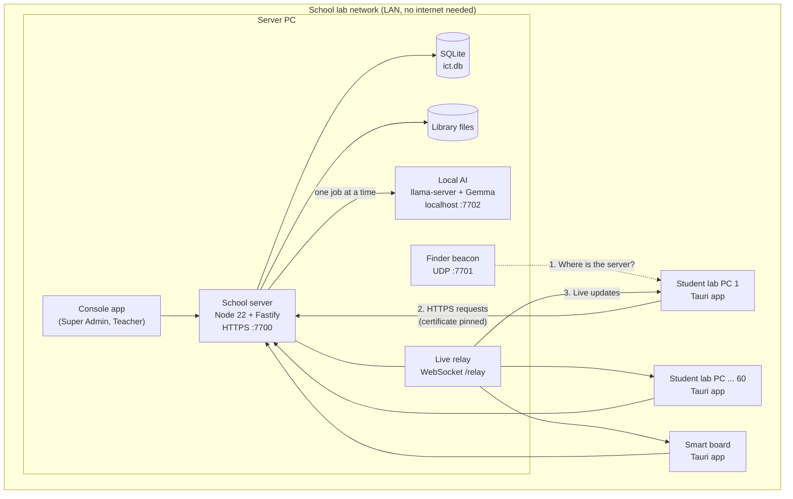
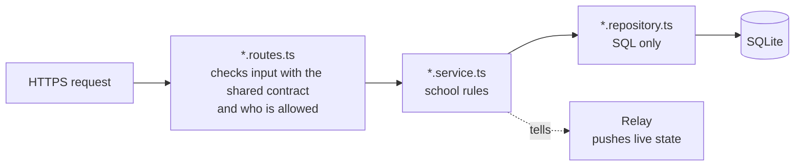

# ICT App

An offline-first classroom platform for one school ICT lab: one **Server PC**, up to 60 **student lab PCs**, and optionally a **smart board**. Everything works with no internet. Student data never leaves the Server PC.

The source of truth is [`docs/ict-app-final-spec.md`](docs/ict-app-final-spec.md). More designs live in [`docs/`](docs/).

## What it does

| Who | What they get |
| --- | --- |
| **Super Admin** | School settings and periods, staff, classes, the list of lab PCs (connected or not), lock the lab, AI on/off |
| **Teacher** | Students and classes, quizzes (also made by AI), live results, notes, notices, timetable booking, work to set and mark, report cards, content library, learning paths |
| **Student** | Sign in by class, roll number and name; quizzes, notes, my work, my books, things to do, how I am doing, ask the AI tutor |
| **Smart board** | Classroom screen joined to the same server |

## System architecture



How it fits together:

1. **Finding the server.** The Server PC sends a small "I am here" message on UDP port 7701. Lab PCs and the board hear it and learn the server's address. Nobody types an IP address.
2. **Joining.** A new lab PC joins the lab by itself. The server names it ("Lab PC 7"). When every PC is in, staff press **Lock the lab** so no other machine can join.
3. **Talking safely.** All requests go over HTTPS on port 7700. The app remembers the server's certificate the first time ("pinning"), so another machine cannot pretend to be the server.
4. **Live changes.** Normal changes (save a note, answer a quiz) go as HTTPS requests. The relay then pushes fresh state to every screen in the same room, so the teacher sees results as students answer.
5. **AI stays on the school PC.** The AI model runs on the Server PC itself. Requests wait in one line and run one at a time, so the PC does not slow down. If AI is not installed or switched off, everything else still works.

### Inside the server



Every feature is one folder in `server/src/modules/` with these three layers. `container.ts` is the only place they are created and wired together.

### One contract for both sides

`contracts/` holds one table of every API endpoint: its path, who may call it, and the exact shape of what goes in and out (written with zod). The server builds its routes from this table, the app builds its calls from it, and `openapi.json` is generated from it. If one side changes a shape, the other side fails to type-check, so they cannot drift apart.

## Code layout

```
contracts/          Shared API contract (zod): endpoints, permissions, openapi.json
server/             School server: Node 22 + Fastify + SQLite
  src/core/         Errors, clock, audit log, contract-driven route helper
  src/infra/        Database + migrations, TLS certificate, finder beacon, network, single-instance lock
  src/modules/      One folder per feature (ai, auth, content, devices, notes, notices, quizzes,
                    report-cards, results, sequences, settings, staff, students, system, timetable, work)
  src/relay/        Live WebSocket at /relay: rooms, pushes fresh state on join and on every change
  src/container.ts  The only place objects are built and wired
  test/             Server tests (vitest)
apps/client/        Tauri 2 + React 19 app: Console, Student PC and Board in one codebase
  src/platform/     Interface to native features (Tauri implementation behind it)
  src/core/         Typed API client, server finder, saved settings
  src/features/     Screens: setup, sign-in, home and one folder per feature
  src-tauri/        Rust: UDP discovery, pinned HTTPS, pinned relay WebSocket, settings file
installer/          Inno Setup script (two installers) + WinSW service definition
docker/             Clean Linux and no-internet test setups
.github/workflows/  Windows build: tests, Tauri app, server bundle, installers
docs/               Spec, PRD, PRAXIS notes, system design
```

## Develop on a Mac

You need Node 22, pnpm 10, Rust and [`just`](https://github.com/casey/just) (`brew install just`). Run `just` to list every shortcut.

```bash
just install
just server   # terminal 1: school server (dev admin: admin / admin123)
just app      # terminal 2: the app. First run compiles Rust for a few minutes.
just student  # optional: a second app window as a Student PC
```

Pick **Server PC** to use the console, or **Student PC** / **Smart board** to test joining. Use **Reset device** in the top bar to switch roles.

Optional AI for development (downloads a 3.1 GB model once; needs `brew install llama.cpp`):

```bash
just ai-dev
```

Dev data lives in `server/.data/`. `just reset-server` wipes it for a fresh start.

## Test

```bash
just test             # server + app + Rust tests
just check            # type-check everything
just e2e              # live check against a running server
just openapi          # regenerate contracts/openapi.json
just docker-offline   # run the server and a "lab PC" on a network with no internet
```

## Windows installers

Every push runs `.github/workflows/windows.yml` on a Windows machine: tests first, then the build. Download the installers from the run's **Artifacts** section on GitHub.

| Installer | Use it on | What it does |
| --- | --- | --- |
| `ICT-Setup` | Server PC or smart board | Asks **Server PC** or **Smart board**. For a server it also asks for the first Super Admin, installs the `ICTServer` Windows service, and opens TCP 7700 + UDP 7701 on Private networks. |
| `ICT-Student-Setup` | Every student lab PC | Asks nothing. Opens straight on the student screens and starts when Windows starts. |

Server data lives in `C:\ProgramData\ICT App\server`.

### Setting up a lab

1. Install `ICT-Setup` on the Server PC and choose **Server PC**.
2. Install `ICT-Student-Setup` on each lab PC. Each one finds the server and joins by itself.
3. In the console, check that every PC shows as connected, then press **Lock the lab**.
4. Teachers add classes and students. Students then sign in with class, roll number and name.

## Ports

| Port | Use |
| --- | --- |
| TCP 7700 | HTTPS API and the live relay (`/relay`) |
| UDP 7701 | Finder beacon, so lab PCs find the server |
| TCP 7702 | Local AI, on the Server PC only (localhost) |
