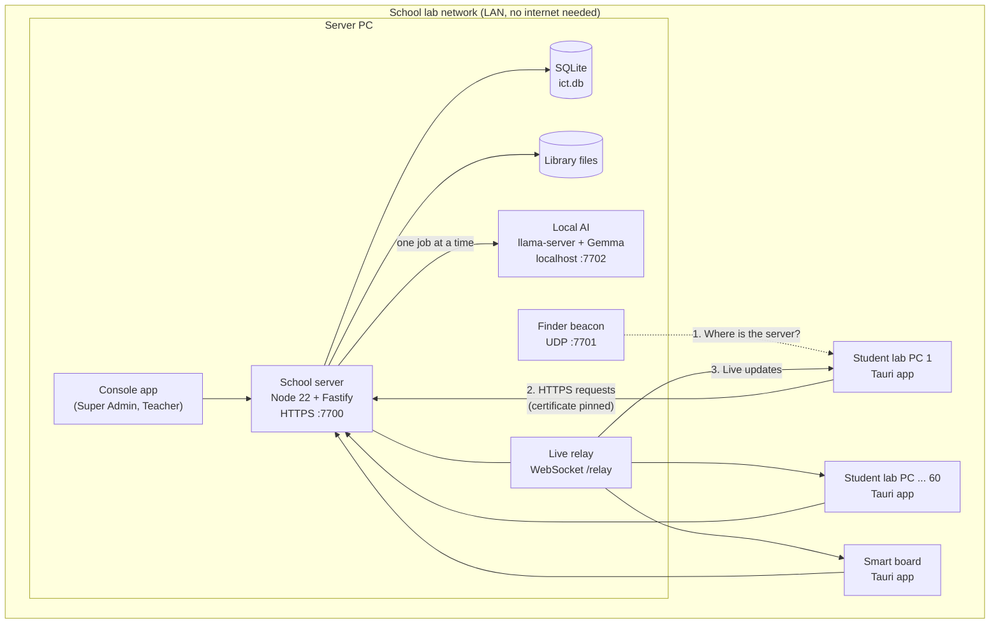
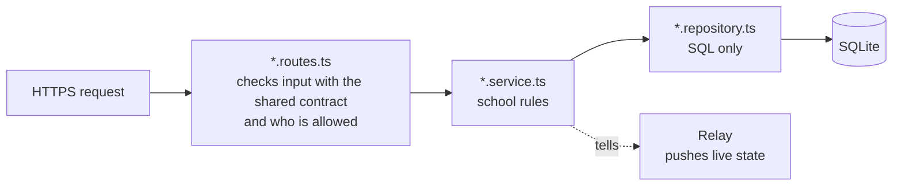

# ICT App

An offline-first classroom platform for one school ICT lab: one **Server PC**, up to 60 **student lab PCs**, and optionally a **smart board**. Everything works with no internet. Student data never leaves the Server PC.

The source of truth is [`docs/ict-app-final-spec.md`](docs/ict-app-final-spec.md). More designs live in [`docs/`](docs/).

## What it does

| Who | What they get |
| --- | --- |
| **Super Admin** | School settings and periods, staff, classes, the list of lab PCs (connected or not), lock the lab, AI on/off |
| **Teacher** | Students and classes, quizzes (also made by AI), live results, notes, notices, timetable booking, work to set and mark, report cards, content library, learning paths |
| **Student** | Sign in by class, roll number and name; quizzes, notes, my work, my books, things to do, how I am doing, ask the AI tutor |
| **Smart board** | Classroom screen joined to the same server |

## Features

The full list, by who uses it.

**Every PC, once**
- Pick what the PC is: Server PC (staff), student PC or smart board.
- Find the lab server and join the lab. Change server and Reset device ask before they wipe anything.
- The app sizes itself to the screen, from a 1024 wide monitor up to 4K.
- English or Marathi: a switch in the top bar, remembered on each PC. The student screens are in both; the teacher screens are still in English only.

**Student**
- Sign in by class and roll number (and section or name when needed).
- Home: today's lab period, notices, books, results and things to do.
- Live quiz: join when the teacher opens it, a clock on every question, the score at the end. When the teacher plays it in teams, the student sees their team's colour and, at the end, every team's place.
- Practice quizzes: under Things to do. No clock, as many tries as they like, and the best try is kept.
- My books: PDFs, pictures, videos, sound and web links from the library.
- Videos: the videos for the student's class, including the ones that come with the app.
- Activities: small interactive lessons and games from the library that need no internet; the score goes to the teacher.
- Things to do: playlists and learning paths, ticked off step by step.
- My work: open work the teacher set, hand it in, see the mark.
- How I am doing: quiz results by subject.
- My notes.
- Ask a question: an AI tutor that gives hints (needs the AI kit on the server).
- Settings: text size, stronger colours, easy-to-read letters. They follow the student to any lab PC.
- Locked down: on a student PC there is no right-click menu, no printing, no saving or downloading, and no way to open the page's code.

**Teacher**
- Today: how every student is doing, to print, save as PDF or download for Excel.
- Attendance: a student who signs in on a lab PC is marked present for the day; the teacher can change it, also for a day gone by.
- Quizzes: write, edit, delete; make one with AI; ask AI a question.
- Plan a lesson with AI: a class, subject, topic and length go in; a timed plan with checks and homework comes out, to read and print.
- Lab Mode: run a quiz live, watch students join and answer, end it. It can be played in 2, 3 or 4 teams; a team's score is the average of its members' scores.
- Give a quiz as practice: the class does it in their own time with no clock. The teacher sees each student's tries and best score. Practice is not used for results or report cards.
- Activities: add one (a single `.html` file, see `docs/activities.md`) to the library and see each student's best score.
- Polls: ask a class one quick question (pick an option, or 1 to 5 stars) and watch the answers come in. No marks, no names.
- Library: add files or web links by class, subject and chapter. A Word, Excel or PowerPoint file is turned into a PDF (needs LibreOffice on the Server PC).
- Videos: the videos for the teacher's classes.
- Class show: play a video on every student screen, with a pen to write over it and to hand to a student.
- Playlists and learning paths made from library items.
- Work: set it for a class and mark what comes in.
- Notices for a class.
- Report cards: made from quiz results and marked work, with remarks, then published and printed.
- School: timetable bookings, the student list, the lab PCs.
- Lock screens: cover one student's screen, or every lab PC at once, with "Look at your teacher" until it is unlocked.

**Super Admin (all of the above, plus)**
- Teachers: add, change, reset a password, delete.
- Students: add, change, delete, add from a file.
- Classes and sections.
- Lab PCs: see which are connected, remove one, lock the lab so no new PC can join.
- What teachers have done, and an activity log of who did what and when.
- System: school name, the periods of the day, AI on or off for teachers, and a switch that locks the lab PCs by themselves whenever the timetable has no class in the lab.
- Notices for the whole school, and freezing a report card for good.

**Smart board**
- Joins the same server. Live lessons on the board come in a later stage.

## System architecture



How it fits together:

1. **Finding the server.** The Server PC sends a small "I am here" message on UDP port 7701. Lab PCs and the board hear it and learn the server's address. Nobody types an IP address.
2. **Joining.** A new lab PC joins the lab by itself. The server names it ("Lab PC 7"). When every PC is in, staff press **Lock the lab** so no other machine can join.
3. **Talking safely.** All requests go over HTTPS on port 7700. The app remembers the server's certificate the first time ("pinning"), so another machine cannot pretend to be the server.
4. **Live changes.** Normal changes (save a note, answer a quiz) go as HTTPS requests. The relay then pushes fresh state to every screen in the same room, so the teacher sees results as students answer.
5. **AI stays on the school PC.** The AI model runs on the Server PC itself. Requests wait in one line and run one at a time, so the PC does not slow down. If AI is not installed or switched off, everything else still works.

### Inside the server



Every feature is one folder in `server/src/modules/` with these three layers. `container.ts` is the only place they are created and wired together.

### One contract for both sides

`contracts/` holds one table of every API endpoint: its path, who may call it, and the exact shape of what goes in and out (written with zod). The server builds its routes from this table, the app builds its calls from it, and `openapi.json` is generated from it. If one side changes a shape, the other side fails to type-check, so they cannot drift apart.

## Code layout

```
contracts/          Shared API contract (zod): endpoints, permissions, openapi.json
server/             School server: Node 22 + Fastify + SQLite
  src/core/         Errors, clock, audit log, contract-driven route helper
  src/infra/        Database + migrations, TLS certificate, finder beacon, network, single-instance lock
  src/modules/      One folder per feature (ai, auth, content, devices, notes, notices, quizzes,
                    report-cards, results, sequences, settings, staff, students, system, timetable, work)
  src/relay/        Live WebSocket at /relay: rooms, pushes fresh state on join and on every change
  src/container.ts  The only place objects are built and wired
  test/             Server tests (vitest)
apps/client/        Tauri 2 + React 19 app: Console, Student PC and Board in one codebase
  src/platform/     Interface to native features (Tauri implementation behind it)
  src/core/         Typed API client, server finder, saved settings
  src/features/     Screens: setup, sign-in, home and one folder per feature
  src-tauri/        Rust: UDP discovery, pinned HTTPS, pinned relay WebSocket, settings file
installer/          Inno Setup script (two installers) + WinSW service definition
docker/             Clean Linux and no-internet test setups
.github/workflows/  Windows build: tests, Tauri app, server bundle, installers
docs/               Spec, PRD, PRAXIS notes, system design
```

## Develop on a Mac

You need Node 22, pnpm 10, Rust and [`just`](https://github.com/casey/just) (`brew install just`). Run `just` to list every shortcut.

```bash
just install
just server   # terminal 1: school server (dev admin: admin / admin123)
just app      # terminal 2: the app. First run compiles Rust for a few minutes.
just student  # optional: a second app window as a Student PC
```

Pick **Server PC** to use the console, or **Student PC** / **Smart board** to test joining. Use **Reset device** in the top bar to switch roles.

Optional AI for development (downloads a 3.1 GB model once; needs `brew install llama.cpp`):

```bash
just ai-dev
```

Dev data lives in `server/.data/`. `just reset-server` wipes it for a fresh start.

### Logs

The server keeps a diary, `events.log`, next to its database (`server/.data/events.log` in development). It has one plain line per event and never leaves the Server PC. Each line also shows in the server's own terminal.

```bash
just logs         # watch everything live
just video-logs   # watch only "Show to class": the show itself and how each student's screen is doing
```

```
2026-11-16 13:05:02  show.started  show="3f9a1c2e"  video="Fractions"  class="7"  by="Ravi K"
2026-11-16 13:05:02  show.screen.opened  show="3f9a1c2e"  student="Asha"  pc="Lab PC 4"  at=0  behind=0
2026-11-16 13:05:09  show.playing  show="3f9a1c2e"  at=0  speed=1
2026-11-16 13:06:40  show.screen.waiting  show="3f9a1c2e"  student="Asha"  pc="Lab PC 4"  at=91.2  behind=4.5
2026-11-16 13:09:31  show.stopped  show="3f9a1c2e"  video="Fractions"  class="7"  by="Ravi K"  screens=38
```

| Line | Meaning |
|---|---|
| `show.started` / `show.stopped` | The teacher started or stopped showing a video. `screens` is how many student screens spoke up. |
| `show.playing` / `show.paused` | The teacher played, paused, jumped or changed speed. `at` is seconds into the video. |
| `show.replaced` | Another show took the class. |
| `show.gone_quiet` | The teacher's app went silent for 20 seconds, so the server ended the show. |
| `show.screen.opened` / `ready` | The video came up on a student's screen / finished loading there. |
| `show.screen.waiting` / `recovered` / `retrying` | The video stopped arriving on that PC / came back / was started afresh. |
| `show.screen.silent` | That PC would not start sound by itself, so it plays without sound. |
| `show.screen.failed` | That PC cannot play the video. |
| `show.pen.given` / `show.pen.taken` | The teacher gave a student the pen to write on the video / took it back. |
| `show.ink.started` / `show.ink.cleared` | Someone began writing on a clean video / the teacher wiped the writing. Single lines are not logged. |

`behind` is how many seconds that screen is behind the teacher. A diary over 5 MB is put aside as `events.log.1` when the server starts.

## Test

```bash
just test             # server + app + Rust tests
just check            # type-check everything
just e2e              # live check against a running server
just openapi          # regenerate contracts/openapi.json
just docker-offline   # run the server and a "lab PC" on a network with no internet
```

## Windows installers

Every push runs `.github/workflows/windows.yml` on a Windows machine: tests first, then the build. Download the installers from the run's **Artifacts** section on GitHub.

| Installer | Use it on | What it does |
| --- | --- | --- |
| `ICT-Setup` | Server PC or smart board | Asks **Server PC** or **Smart board**. For a server it also asks for the first Super Admin, installs the `ICTServer` Windows service, and opens TCP 7700 + UDP 7701 on Private networks. |
| `ICT-Student-Setup` | Every student lab PC | Asks nothing. Opens straight on the student screens and starts when Windows starts. |

Server data lives in `C:\ProgramData\ICT App\server`.

### Setting up a lab

1. Install `ICT-Setup` on the Server PC and choose **Server PC**.
2. Install `ICT-Student-Setup` on each lab PC. Each one finds the server and joins by itself.
3. In the console, check that every PC shows as connected, then press **Lock the lab**.
4. Teachers add classes and students. Students then sign in with class, roll number and name.

### Videos that come with the app

Our own videos and books are given out **locked**, so that a copy of the file plays in no other program. A locked file is named like `G6-...mp4.ictlock`. Only an ICT App server built with our key can play it, and it stays locked on the Server PC's disk too.

1. The key is 64 letters and digits. It is kept in two places: the file `~/.ict/content-key` on the Mac, and the GitHub secret `ICT_CONTENT_KEY`, which the build writes into the server. Keep a third copy somewhere safe. **If the key is lost, the locked files can never be opened.**
2. Lock the videos: `node installer/lock-videos.mjs <folder of videos> --out <folder for the zip>`.
3. Give out only the `.ictlock` files. In the school, `2-add-videos.bat` copies them from the `videos` folder beside it into the server.

The lock stops someone copying the file and playing it elsewhere. It does not stop someone filming or recording the screen, and a skilled person could dig the key out of the server program.

To test a new build on real Windows PCs, follow [`docs/windows-test-guide.md`](docs/windows-test-guide.md).

## Ports

| Port | Use |
| --- | --- |
| TCP 7700 | HTTPS API and the live relay (`/relay`) |
| UDP 7701 | Finder beacon, so lab PCs find the server |
| TCP 7702 | Local AI, on the Server PC only (localhost) |
