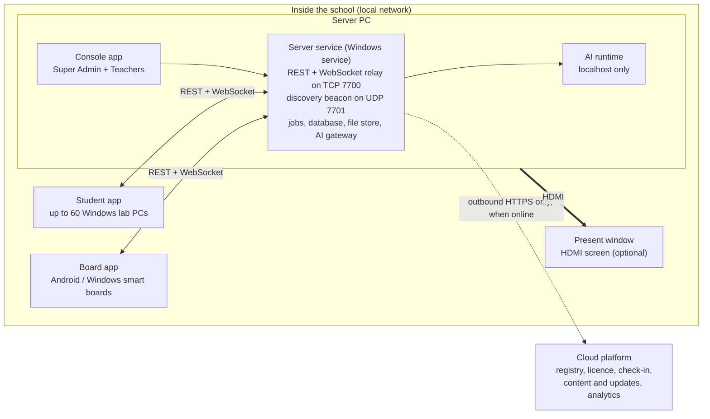
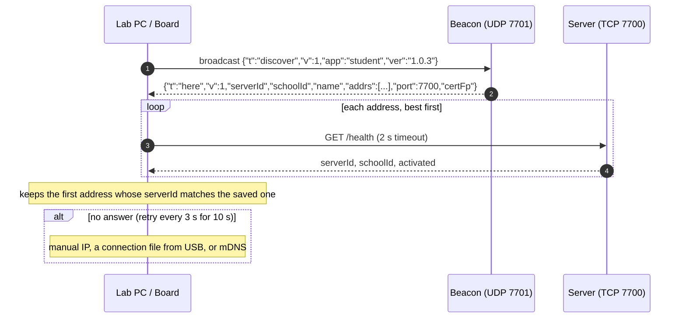
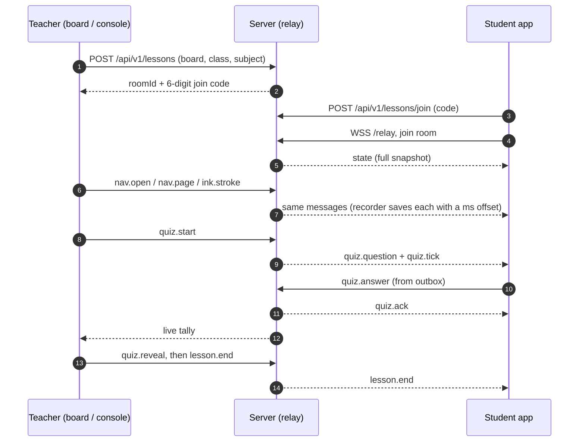
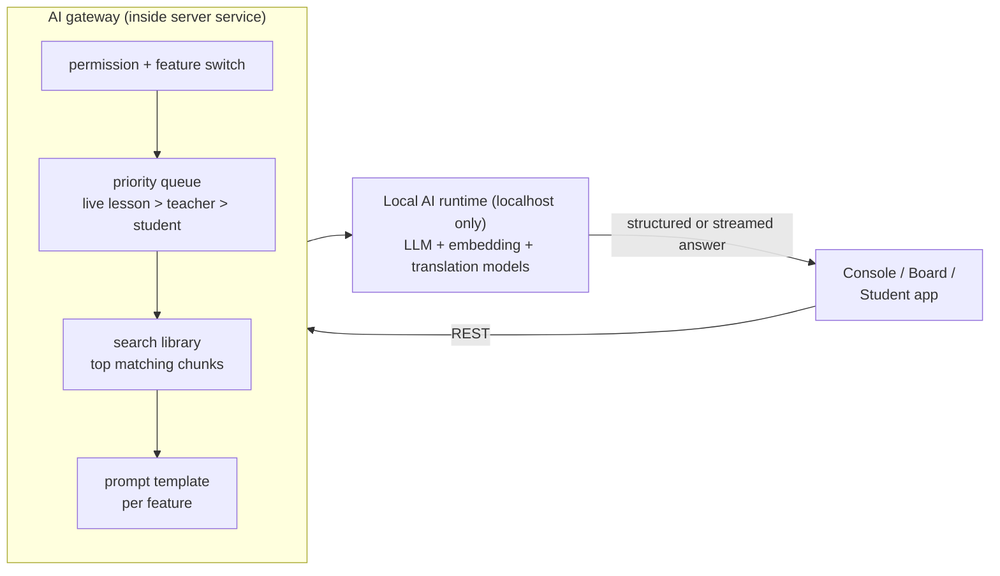
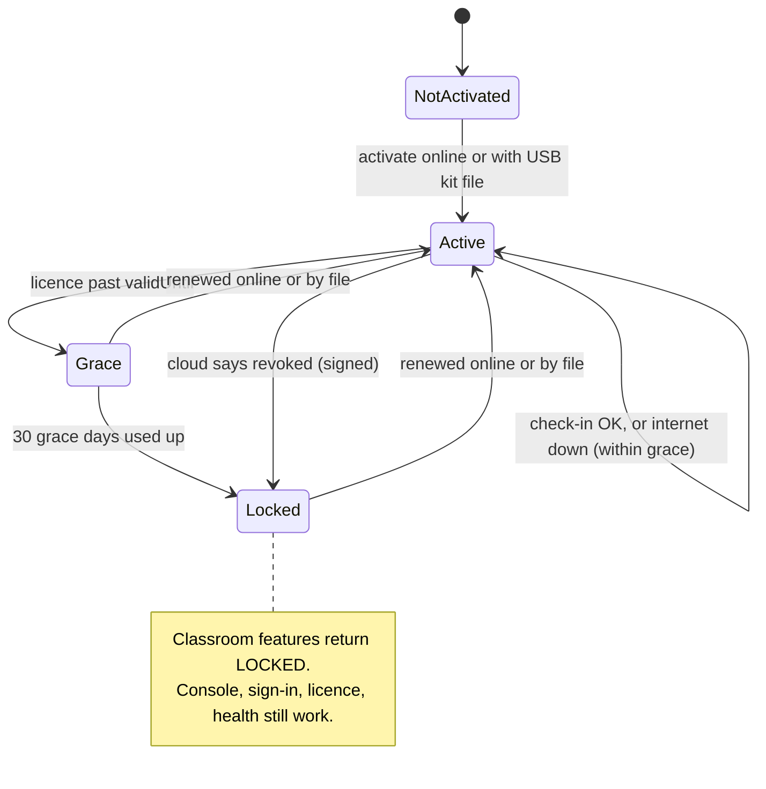

# ICT App: Final Build Spec

**ICT App = PRAXIS (every feature) + Tech PRD: Offline-First ICT Lab v1.1 (every feature) + fixes for the PRAXIS weak spots.**

Version 1.0 · 23 October 2026 · Source files in this folder:
- `praxis-system-design.md`: how PRAXIS 1.1.0 works (reverse-engineered)
- `tech-prd-ict-lab-v1.1.md`: the ICT Lab Tech PRD v1.1

Every feature below is tagged with where it came from:
- **[PRAXIS]**: PRAXIS has it; the PRD does not.
- **[PRD]**: the PRD asks for it; PRAXIS does not have it.
- **[BOTH]**: both have it; we use the stronger version.
- **[NEW]**: added here to fix a gap or a PRAXIS weakness.

Priority: **P0** = first pilot, **P1** = general release, **P2** = later.

---

## 0. Decisions already made

| Question | Decision | Why |
|---|---|---|
| Devices | **Windows server + Windows lab PCs + Android smart boards** | The PRD covers Windows labs; PRAXIS also supports Android panels. We keep both. |
| Lesson recording | **Both:** event recording (default) **and** optional screen + audio video | Event recording is tiny and replays exactly (PRAXIS). Video catches what events can't, like spoken explanation (PRD). |
| Tech tools | **Named in this spec** (Section 12) | So the team can start building now. |
| Internet | Never needed to teach. Used only for check-in, downloads and analytics upload. | PRD rule; PRAXIS also works this way. |
| Student data | Never leaves the server PC | Both agree. |
| When PRAXIS and the PRD disagree | The **safer** rule wins (PRD security, PRD sessions, PRD signing) | PRAXIS has known security gaps (Section 11). |

---

## 1. What we are building

One server PC per school runs everything. All classroom devices connect to it over the school's local network:
- up to 60 Windows lab PCs
- Android or Windows smart boards
- an optional HDMI screen on the server

The cloud is only a background helper. The server reaches out to it; the cloud never connects in.



### The apps

| App | Runs on | Who uses it | Source |
|---|---|---|---|
| **Server service** | Server PC, starts at boot as a Windows service | (no screen) | [BOTH] PRAXIS ran it inside a tray app; PRD makes it a real Windows service so it survives sign-out and crashes |
| **Console** | Server PC monitor (separate process) | Super Admin, Teachers | [BOTH] |
| **Present window** | Server PC, full-screen on HDMI | Class watches it | [PRD] |
| **Student app** | Each Windows lab PC | Students (and guardians in Family mode, P2) | [BOTH] |
| **Board app** | Android smart panels, or a Windows PC acting as a board | Teacher at the front of the class | [PRAXIS] |
| **Teacher remote** (P1) | Teacher's Windows laptop or Android tablet on the school Wi-Fi | Teachers driving a board lesson from the room | [PRAXIS] PRAXIS has a separate Teacher app |
| **Cloud platform** | Our hosting | Tech team only | [BOTH] |

**One codebase for all screens.** Console, Present window, Student app, Board app and Teacher remote are built from one Flutter codebase. The app's role is set at install time; PRAXIS did the same with one `praxisRole` setting. [BOTH]

One Windows installer. Its first screen asks: **Server**, **Student PC** or **Board**. The Android board is a separate APK. [PRD + PRAXIS]

---

## 2. Design rules (do not break these)

1. **Offline first.** Nothing waits on the cloud while handling a request. Cloud calls run only on timers; failures are logged and retried. [BOTH]
2. **The server owns all data and logic.** Every app is a thin screen over REST + WebSocket. [PRD]
3. **The console is a separate process.** Closing or crashing it never stops the server. [PRD]
4. **The cloud never calls in.** The school server starts every cloud request. [PRD]
5. **Remember the server's ID, not its IP.** Devices store the `serverId` and find its current address by broadcast. School routers change IPs often. [PRAXIS]
6. **Download once, share many times.** The server downloads content and app updates once over the internet, then devices fetch them over the LAN. [PRAXIS]
7. **Never lose an answer.** Answers, attendance and submissions are confirmed ("acked") by the server. Until then the app keeps them in an outbox and resends. [PRD]
8. **Everything from outside is signed.** Licences, updates, content, AI models and USB kits are signature- and checksum-checked before use. [PRD]
9. **Watching is always visible.** If anyone views a screen (office → board, teacher → student), the watched device shows an indicator. Live frames are never stored. [PRAXIS]
10. **Privacy by allow-list.** Analytics accept only allow-listed fields; an automated test proves it. [PRD]
11. **One bad message can't crash the school.** Every relay message handler is wrapped so errors are logged and dropped. [PRAXIS]
12. **Licence lockdown never comes from a dead internet line alone.** Only a signed "not allowed" answer or an expired grace period can lock the school. [BOTH]

---

## 3. Roles and sign-in

| Role | Who | Signs in on | Credential | Session | Source |
|---|---|---|---|---|---|
| **Super Admin** | Our field person, on-site | Console | Username + password from the signed field-person list; works offline | 15 min idle | [PRD] |
| **Teacher** | School teachers | Console, Board, Teacher remote | Username + password set by the Super Admin | 15 min idle; "Switch teacher" ends it | [BOTH] |
| **Student** | Students | Student app | Class + name + 4-digit PIN, or printed QR card, or one-time enrolment code (first login) | Sign-out, lesson end, or 10 min idle | [BOTH] PIN/QR from PRD, enrolment code from PRAXIS |
| **Device** | Lab PC or Board | (automatic) | Device token from the enrol window | 90 days, auto-renewed while in use; revoked on retire or re-key | [NEW] PRAXIS used 10-year tokens |
| **Guardian** (P2) | Parent at a school meeting | Student app in Family mode | Family PIN for one child | 1 hour; only `/api/v1/family/*`; no live WebSocket | [PRAXIS] |

**Teacher permission switches** [PRAXIS]: by default all teachers are equal (PRD). The Super Admin can turn off **can host lessons** or **can upload content** for a teacher.

### Permission keys

Defined once. The server checks them on every REST route and every relay message, and the UI uses them to hide buttons. [PRD]

| Permission | Super Admin | Teacher | Student | Guardian |
|---|---|---|---|---|
| `staff.manage` | Y | - | - | - |
| `students.manage` (add, edit, import, PIN cards, enrolment codes, guardian PINs) | Y | Y | - | - |
| `setup.*` (devices, master data, content, timetable) | Y | Y | - | - |
| `teaching.*` (quizzes, playlists, paths, week ahead, work, activities, recordings, notices, messages, study rooms, Together monitor) | Y | Y | - | - |
| `lesson.start` / `lesson.control` / `lesson.present` | Y | Y (unless switched off) | - | - |
| `screen.watch` (view a board or student screen) | Y | Y (own lesson's students) | - | - |
| `results.view` | Y | Y | own only | own child only |
| `ai.teacher` / `ai.tutor` | teacher | teacher | tutor | - |
| `licence.view`, `updates.view` | Y | Y | - | - |
| `licence.renew`, `updates.install`, `settings.*`, `server.manage` | Y | - | - | - |

**Sign-in safety** [BOTH + NEW]:
- PIN lockout after 5 wrong tries, for 5 minutes. Sign-in is rate-limited per device.
- Passwords and PINs are stored with **bcrypt** (cost 10). Session tokens are 32 random bytes, and only their **SHA-256** hash is stored. [PRAXIS]
- Permissions are re-read on every request, so a switch flipped in the console takes effect at once. [PRAXIS]
- Tokens are sent only in the `Authorization` header, never in URLs. Media files use short-lived signed links. [NEW]

---

## 4. Features: Console (server PC)

All features are for Super Admin and Teachers unless marked otherwise.

### 4.1 Overview and people

| Feature | Pri. | What it does | Source |
|---|---|---|---|
| Overview | P0 | Today's planned and live lessons, PCs and boards connected, students signed in. Alerts: PCs offline, disk low, licence expiring, no check-in for 14+ days, **Wi-Fi blocks devices from reaching the server**. Footer shows "Serving the lab" and the last check-in. | [BOTH] The Wi-Fi alert is from PRAXIS |
| Students | P0 | Add, edit, delete, bulk import (Excel/CSV), move section, promote class, print PIN/QR cards, reset PIN, one-time enrolment codes per student or per class. Soft delete; duplicate check on name + class + roll; import returns a per-row error report. | [BOTH] |
| Guardians | P2 | Set guardian name and family PIN per student | [PRAXIS] |
| Staff (Super Admin) | P0 | Add, edit, delete teachers; reset password; switch "can host lessons" and "can upload content" | [BOTH] |
| Audit log (Super Admin) | P0 | Who did what and when: sign-ins, deletes, licence and update actions, screen watching | [PRAXIS] |

### 4.2 Lab and school setup

| Feature | Pri. | What it does | Source |
|---|---|---|---|
| Devices | P0 | Enrol lab PCs **and boards** in a 30-minute enrol window. Link a board to a class and section. List status, last seen, version, current lesson. Rename, retire, re-key. Commands: lock, unlock, lock all, restart app, reload, open content, "look at the front". Commands are sent over the relay with an ack, and also queued in the database so an offline device gets them when it returns. PC limit comes from the licence. | [BOTH] The command queue is from PRAXIS |
| Lock policy | P1 | Rules for when devices lock automatically (e.g. outside lab periods) | [PRAXIS] |
| Master data | P0 | Classes, subjects and languages come from the school profile (read-only). The school names sections and sets period times. | [BOTH] |
| Timetable | P1 | Weekly lab grid by period with clash checks; drives the week ahead, the student Today screen and reminders | [BOTH] |
| Content library | P0 | PDF, images, video, audio, slides, **Office files (Word, Excel, PowerPoint)**, HTML5 packages, video links. Filed by class, subject and chapter. Max 512 MB per upload, streamed, file type checked from the file's contents. Files are named by their SHA-256 fingerprint, so duplicates are stored once. Links are flagged `needs_internet`. Text is extracted and indexed for AI. Office files are converted to PDF on the server for viewing. | [BOTH] Office support is from PRAXIS |
| Shared library | P0 | Content pushed from the cloud library (by class and subject), downloaded once and checksum-checked. Teachers' own uploads sit alongside. | [PRAXIS] |
| Content notes and progress | P1 | Teacher notes on a content item; per-student reading/watching progress | [PRAXIS] |

### 4.3 Teaching and assessment

| Feature | Pri. | What it does | Source |
|---|---|---|---|
| Quizzes & polls | P0 | Question types: single, multiple, true/false, image, number, short text. Poll types: choice, rating, word cloud. Settings: seconds per question (0 = teacher moves on). Live run with server-timed countdown, tally, reveal, leaderboard (can be hidden). Self-paced mode as homework. Generate with AI. Answers count if the student's timestamp is before the close. Polls are never scored. | [BOTH] |
| Team quiz | P1 | Split the class into teams; team standings | [BOTH] |
| Plan a lesson (AI) | P0 | Give a topic, class, subject and minutes (default 40). Get objectives, timed steps, library items, checks and homework. Edit or regenerate parts. Save to the week ahead or open in Present mode. | [BOTH] PRAXIS sent this to a remote AI; we run it locally |
| Work (assignments) | P0 | From a quiz, worksheet, file task or library item. Due date, marks, reference files. Students submit text, file, drawing or webcam photo. Submissions are append-only; late ones are flagged. Teacher marks with comments. | [BOTH] |
| Activities | P0 | Offline interactive packages (`.praxis`-style packs, Anganwadi to Class 12). They run sandboxed and report score, time and completion through a message API. A starter pack ships with the installer. | [BOTH] The starter pack is from PRAXIS |
| External activities | P1 | Games or apps installed on the lab PC, granted by the platform, launched from the app ("quick apps") | [PRAXIS] |
| Playlists | P1 | Ordered videos, links, PDFs and activities for a chapter. Played on the board or Present screen, or sent to lab PCs. `needs_internet` items are skipped when offline. | [BOTH] |
| Learning paths | P1 | Steps: watch, read, activity, quiz check, assignment. Optional prerequisites. AI can draft one from the library. Completion is recorded per student. | [BOTH] |
| The week ahead | P1 | Mon–Sun plan per slot (content, playlist, path step, quiz). 5 minutes before, a reminder fires and the files are pre-loaded onto that class's PCs. | [BOTH] |
| Recorded lessons | P1 | **Event recording** (default): every lesson event (open file, page, scene, quiz question, ink) is saved with a millisecond offset, so the lesson can be replayed exactly. **Video recording** (optional): Present or board screen + audio, no camera. Replay from My books. Teachers can delete. | [BOTH] |
| Whiteboard | P0 | Multi-page whiteboard per lesson; pages saved on the server | [PRAXIS] |
| Notices | P1 | One-way notices to the school, a class or a section, with pin and expiry | [BOTH] |
| Messages | P1 | Teacher ↔ student messages (and teacher ↔ guardian in P2). Kept on the server. | [PRAXIS] |
| Study rooms | P1 | Teacher-run group space with whiteboard and chosen content | [BOTH] |
| Together monitor | P1 | See open student Together rooms and members; join read-only or with pen; close | [PRD] |

### 4.4 Results and insights (in school only)

| Feature | Pri. | What it does | Source |
|---|---|---|---|
| Quiz results & marks | P0 | Per student and class; export Excel/PDF. Never in the analytics upload. | [BOTH] |
| Attendance | P0 | Taken automatically when a student joins a lesson; teachers can edit | [BOTH] |
| Student analytics | P1 | Attendance, lessons joined, accuracy by subject and chapter, work on time, path progress, weakest chapters | [BOTH] |
| "Next steps" per child | P1 | Suggestions worked out on the server from the student's activity log, with simple rules (no AI) | [PRAXIS] |
| Reports | P1 | Lab usage, attendance and assessment summaries; export | [BOTH] |
| Report cards | P1 | Built from marks with teacher remarks. Draft, then published, then frozen (cannot change). PDF print. | [BOTH] |

### 4.5 System

| Feature | Pri. | What it does | Source |
|---|---|---|---|
| Licence | P0 | School ID, valid until, PCs allowed, last check. Signed token checked offline; 30-day grace period. Teachers view; Super Admin renews online or by file. | [PRD] |
| Lockdown | P0 | If the licence is revoked or the grace period ends, classroom features return "locked". The console, sign-in, licence and health pages still work so staff can see why and renew. | [PRAXIS] |
| Updates | P0 | Installed and available versions with notes. Super Admin installs, rolls back, imports an update kit, sets a policy (e.g. after hours). Never installs during a live lesson. The server downloads once, then lab PCs and boards update from it over the LAN. | [BOTH] |
| Settings (Super Admin) | P0 | School name, logo, periods, student sign-in method, AI switches, Together on/off, backup location, cloud address override | [BOTH] |
| Server manager (Super Admin) | P0 | Relay status, PCs connected, PCs that "asked but could not connect", cloud check-in and upload backlog, content on disk, network addresses (virtual adapters hidden), AI engine status. Buttons: check in now, fix firewall, export analytics to USB, fetch content, restart relay/AI, export a connection file. | [BOTH] |
| Backups | P0 | Nightly backup of the database + file list; keep 7; restore from the console | [PRD] |

### 4.6 Present mode (optional, HDMI on the server)

[PRD]
- Used only when a screen is plugged into the server PC. Without one, lessons run from a board or the console, and the teacher reads the join code aloud.
- **Two screens:** Present is full-screen on the HDMI screen, and the console stays on the server monitor. **One screen:** Present is full-screen with a floating control bar.
- **Shows:** idle screen (school, period, clock, next lesson), content, join code (can be hidden), quiz countdown and results, whiteboard, playlist steps, Ask AI output (P1).
- **Controls:** next/previous, play/pause, annotate, whiteboard, quiz/poll start and reveal, blank, lock lab PCs, show/hide code, end lesson. Keyboard shortcuts and USB touch.
- The Present window only ever shows presentation screens: never student lists, results or settings.
- It connects to the relay like any other device, as a special "present" device of the server.

---

## 5. Features: Board app (Android or Windows smart board)

[PRAXIS], with PRD rules applied.

| Feature | Pri. | What it does |
|---|---|---|
| Setup | P0 | Finds the server by broadcast. The installer enters the enrol code once, and the board is linked to a class/section. |
| Home | P0 | School, current period, next lesson, "Start lesson" for the signed-in teacher |
| Teacher sign-in | P0 | Username + password, or a code shown on the console |
| Lesson | P0 | Opens content (PDF, Office, video, images, HTML5 activities, playlists). Page, scene and media controls. Split screen (two items side by side). |
| Ink & whiteboard | P0 | Pen and annotation layer over any content; multi-page whiteboard; Devanagari typing |
| Pen sharing | P1 | A student asks for the pen; the teacher allows or refuses; several holders at once |
| Quiz | P0 | Runs live quizzes and polls; shows countdown, tally, leaderboard |
| Cast | P1 | Shows a student's screen on the board (live frames, never saved) |
| Camera | P1 | Document camera: show a book or object through the board's camera |
| Lock screen | P0 | Locked or blanked when commanded |
| Notices | P1 | School and class notices |
| Attendance register | P1 | Quick attendance sheet for the class |
| Self-update | P0 | Downloads new versions from the school server, not the internet |

---

## 6. Features: Student app (Windows lab PC)

| Feature | Pri. | What it does | Source |
|---|---|---|---|
| Sign-in | P0 | Pick class, tap name/photo, enter PIN; scan QR card with the webcam; or use an enrolment code the first time | [BOTH] |
| Today | P0 | Greeting, current lab period, "Join the lesson" with a 6-digit code, live-lesson card (P1), shortcut cards. Clear messages: "not running in your class", "lesson has ended". | [PRD] |
| In-lesson view | P0 | Follows the teacher's screen, or free mode. Answers quizzes and polls. Draws when given the pen. Private notes. Raise hand, "I'm stuck". Locked or blanked on command. Late joiners get the current state at once. | [BOTH] |
| Screen watched indicator | P0 | A clear banner whenever a teacher is viewing this screen | [PRAXIS] |
| My books | P0 | Books and library items by subject and chapter; recorded lessons; remembers the page. Cached on the PC (least-recently-used files removed first, 10 GB cap). | [PRD] |
| Things to do | P0 | Activities, playlists and path steps with done ticks and the next step | [PRD] |
| My work | P0 | To do, submitted, marked. Submit text, file, drawing or webcam photo, even offline (outbox). See marks and comments. | [BOTH] |
| How I am doing | P1 | Own attendance, lessons joined, work on time, accuracy by subject, path progress, "try this next" | [BOTH] |
| Notices & messages | P1 | Class notices (newest first) and messages from teachers | [BOTH] |
| Together | P1 | Start or join a room by code. Shared whiteboard (pen, shapes, text, sticky notes, library images) for up to 6. Saved to My work. No chat or voice. Same class by default. Closes after 60 min idle. Banner: "teacher can see this room". Super Admin can switch it off. | [PRD] |
| Ask (AI tutor) | P1 | Typed questions answered from the school's own books, with citations. Hints, not assignment answers. Daily limit. | [PRD] |
| Family mode | P2 | A guardian signs in with the family PIN to see their child's attendance, reports and messages, and to set language | [PRAXIS] |
| Settings | P0 | Language, text size, high contrast, dyslexia-friendly font, sign out. Meets WCAG 2.1 AA. | [PRD] |
| Status chip | P0 | "Connected", "Reconnecting…", "Working offline: N answers waiting" | [PRD] |
| Locked-down shell | P0 | No downloads, Save As, printing or dev tools; can't open other apps except granted quick apps. Only the camera and microphone are allowed. | [PRAXIS] |

---

## 7. Server service: how it runs

### 7.1 Startup order

1. Starts at boot as a Windows service and restarts itself on failure. [PRD]
2. Takes a single-instance lock. Two copies would fight over the port and database. [BOTH]
3. Opens the database, runs numbered migrations, checks the licence. [PRD] PRAXIS added missing columns at startup instead of using migrations.
4. Fills in any missing daily totals and closes recordings left "running" after a crash. [PRAXIS]
5. Listens on TCP `7700` (private network adapters only) and UDP `7701`. If 7700 is taken, the console shows which program has it. [BOTH]
6. Installs the starter activity pack if it isn't there yet. [PRAXIS]
7. Starts the AI runtime if models are installed, at lower priority, and restarts it if it crashes. [PRD]
8. Starts background jobs. The console connects to `localhost:7700`. [PRD]
9. Startup errors are written to `startup.log` next to the database. [PRAXIS]

### 7.2 Background jobs

| Job | When | What it does | Source |
|---|---|---|---|
| Check-in | Every 15 min, if online | Heartbeat to the cloud, then act on the returned actions | [BOTH] |
| Sync | After check-in (at least hourly) | Send changed device records and daily totals (rows marked `dirty`); fetch new content, games, releases and profile changes | [PRAXIS] |
| Downloads | After check-in | Content, updates and models, one at a time. Resumable; checksum and signature checked. | [BOTH] |
| Analytics | Nightly roll-up; upload after check-in | Seal batches, upload oldest first, go slow during school hours | [PRD] |
| Backup | Nightly | Database + file list to the backup folder; keep 7 | [PRD] |
| Indexing | When content changes | Extract text, split into chunks, embed, store vectors | [PRD] |
| Reminders | Every minute | Lessons starting in 5 min: notify the console, pre-load files | [PRD] |
| Cleanup | Nightly | Expire codes, close idle rooms, delete AI prompts older than 90 days, drop unsent analytics older than 180 days | [PRD] |

### 7.3 Windows integration

- The installer adds firewall rules for TCP 7700 and UDP 7701 on Private networks and warns on Public ones. A "fix firewall" button repeats this. [BOTH]
- The school key, licence and TLS key are encrypted with Windows machine-level protection (DPAPI). [PRD]
- The licence is tied to the main physical network card; virtual adapters are ignored. [PRD]

---

## 8. Networking and real-time

### 8.1 Finding the server (discovery)



- Devices save the **serverId**, not the IP. They re-discover only when the saved address fails. [BOTH]
- Virtual adapters (Hyper-V, WSL, VPN) are left out of the address list or put last. [BOTH]
- The server records devices that ask but never connect. That pattern means the Wi-Fi is blocking devices from talking to each other ("AP isolation"), and the console warns about it. [BOTH]

### 8.2 Encryption on the school network [NEW]

PRAXIS sends everything on the school network as plain HTTP, so anyone on the Wi-Fi can read tokens. We fix that:
- At install, the server makes its own TLS certificate.
- The enrol window gives each device the certificate's fingerprint (`certFp`). From then on, the device only trusts that exact certificate ("pinning").
- All traffic uses HTTPS and WSS (WebSocket over TLS) on port 7700. No internet or outside certificate authority is needed.

### 8.3 Real-time relay

One WebSocket per device at `wss://<server>:7700/relay`, using the session token. Rooms are joined by message. [PRD]

**Message envelope:**
```
{"t":"<type>","room":"<roomId>","seq":1042,"ts":1729650000123,"id":"<uuid>","p":{...}}
 seq = server order per room   ts = server clock   id = client message id (to drop duplicates)
```

**Message types** (PRD names, plus the PRAXIS features the PRD lacks):

| Group | Types | Source |
|---|---|---|
| Session | `hello`, `ping`/`pong` (clock sync), `join`, `leave`, `state` (full snapshot), `roster.update`, `error` | [BOTH] |
| Navigation & media | `nav.open`, `nav.page`, `nav.scroll`, `nav.scene`, `split.set`, `playlist.next`, `media.play`, `media.pause`, `media.seek`, `activity.open`, `activity.state` | [BOTH] |
| Ink & whiteboard | `ink.stroke` (batched every 50 ms), `ink.undo`, `ink.clear`, `ink.pen`, `pen.request`, `pen.grant`, `pen.refuse`, `pen.holders`, `wb.page` | [BOTH] |
| Assessment | `quiz.start`, `quiz.question`, `quiz.tick`, `quiz.answer`, `quiz.ack`, `quiz.reveal`, `quiz.board`, `poll.result` | [PRD] |
| Control | `ctl.lock`, `ctl.unlock`, `ctl.blank`, `ctl.attention`, `ctl.command` + `ctl.ack`, `lesson.end` | [BOTH] |
| Screens | `cast.start`, `cast.frame`, `cast.stop`, `watch.start`, `watch.stop`, `watch.state` (tells the watched device), `screen.frame` | [PRAXIS] |
| Student signals | `hand.raise`, `hand.stuck`, `presence` | [PRD] |
| System | `content.changed`, `update.ready`, `system.status`, `ai.chunk`, `ai.done` | [BOTH] |

**Rules:**
- Role and room membership are checked on every message. [PRD]
- Control messages over 64 KB are rejected; big data goes over REST. Screen frames are allowed up to ~700 KB, and if a device is slow its old frames are dropped rather than queued. [BOTH]
- Slow devices get a fresh `state` snapshot instead of a growing queue. [PRD]
- Late joiners get the current state at once: what's on screen, pen holders, any running quiz. [BOTH]
- Critical writes (answers, attendance, submissions) are acked; devices resend from the outbox until they get an ack. [PRD]
- Reconnect waits 1, 2, 4 … up to 30 s, then rejoins and gets the state. [PRD]
- Join codes are 6 digits, unique among open rooms, and die with the room. Wrong guesses are rate-limited. [PRD]
- One room per board: if a board already has a lesson, a new teacher joins it instead of opening a second one. [PRAXIS]
- Every handler is wrapped so one bad message is logged and dropped, never crashing the server. [PRAXIS]
- Live room state is held in memory. Lasting facts (lesson, participants, quiz run, recording events) go to the database. [PRAXIS]
- Speed targets: navigation/control under 300 ms (p95) to 60 PCs; ink under 200 ms; media screens in sync within 500 ms. [PRD]

### 8.4 A live lesson



---

## 9. Offline AI

[PRD], replacing the PRAXIS remote AI service.



| Feature | Endpoint | Returns | Pri. |
|---|---|---|---|
| Lesson plan | `/ai/lesson-plan` | objectives[], steps[{minutes, activity, contentIds[]}], checks[], homework | P0 |
| Quiz & worksheet | `/ai/quiz` | questions[{type, text, options[], answer}], saved as a draft quiz | P0 |
| Ask the library | `/ai/ask` | streamed answer + citations[{contentId, page}] | P1 |
| Draft learning path | `/ai/path-draft` | steps[{type, contentId}] from existing chapter items | P1 |
| Student tutor | `/ai/tutor` | streamed hints, limited to the class syllabus | P1 |
| Translate & simplify | `/ai/translate` | Hindi and other Indian languages | P1 |
| Present / board Ask AI | `/ai/ask` (lesson priority) | streamed to the board or Present window via the relay | P1 |

- Models: open models whose licences allow government and commercial use, picked by benchmarking (see Section 12).
- Model packages are signed (name, version, checksum, recommended settings) and delivered by USB kit or cloud.
- Install checks CPU, RAM and GPU and tunes the runtime.
- Limits: one request per user at a time, a daily cap for students, 120 s timeout. Users see their place in the queue.
- No model installed: `/ai/*` returns `AI_NOT_INSTALLED` and the UI shows an empty state.
- Prompts and outputs are deleted after 90 days.

---

## 10. Cloud, licence, USB kit and analytics

### 10.1 Cloud services [PRD]

| Service | Job |
|---|---|
| School registry + admin UI | Schools (School ID, UDISE+, district, state, profile, PC quota, field person, status); internal UI behind company sign-in |
| Licence service | Signed licence tokens; offline activation and renewal files |
| Check-in API | Receives heartbeats; returns pending actions |
| Content & update store | Content packs, shared library, games, signed app builds (Windows + Android), AI models, signed manifests; CDN delivery |
| Kit builder | Builds a school's USB kit from the registry |
| Analytics ingest + warehouse | Checks and stores usage events; read by the tech team's BI tool |

### 10.2 Identity and signing

- At activation the server gets its School ID and licence, makes its own key pair, and registers the public key. [PRD]
- Every cloud request carries the School ID, the time and a signature. The cloud rejects unknown keys and clocks more than 10 minutes off. [PRD]
- HTTPS with certificate pinning to our own certificate authority, never plain HTTP to a bare IP (a PRAXIS problem). [PRD + NEW]
- Cloud address order: admin setting, then the address used at activation, then the built-in default. This lets us move hosts without reinstalling. [PRAXIS]

### 10.3 Check-in contract

```
POST /v1/checkin
{ "schoolId":"SCH-0007", "ver":{"server":"1.0.3","student":"1.0.3","board":"1.0.3","models":"2026.10"},
  "health":{"uptimeH":212,"diskFreeGb":118,"pcsOnline":34,"boardsOnline":4,"backlogBatches":3},
  "manifests":{"content":"<hash>","profile":"<hash>","fieldPeople":"<hash>"} }

200 { "licence":"<signed token|null>", "uploadAnalytics":true,
      "actions":[{"type":"download","kind":"content","manifest":"<url>"},
                 {"type":"update","kind":"app","target":"student","version":"1.0.4","policy":"after-hours"},
                 {"type":"fieldPeople","bundle":"<signed>"},{"type":"profile","bundle":"<signed>"}] }
```

- **Licence token:** signed {schoolId, adapter hash, pcQuota, boardQuota, validUntil, graceDays}; checked offline.
- **Downloads:** listed in signed manifests (path, size, checksum); resumable; checked before use.
- **Field-person bundle:** signed list {username, password hash, active}; replaces the local list in one step.

### 10.4 Licence states



### 10.5 USB kit (schools with no internet)

[PRD]
```
KIT-SCH-0007-2026-10-23/
  kit.json           signed manifest of everything below
  installer/         signed Windows installer + board APK
  activation.lic     signed activation (schoolId, licence, cloud public key)
  profile.json       signed profile (master data, settings, update policy)
  field-people.json  signed field-person list
  content/ models/   packs + manifests
  returns/           server writes analytics exports here
```
Import checks every signature and checksum, then applies them in order: activation, profile, field people, content, models, app update.

### 10.6 Analytics

> **Hard rule:** analytics never contain a person or learning data. Only allow-listed fields get through, and an automated test checks this. [PRD]

```
{"e":"lesson.presented","ts":"2026-10-23T09:05:11Z","schoolId":"SCH-0007","app":"server",
 "ver":"1.0.3","role":"teacher","dims":{"class":"7","subject":"science"},
 "m":{"minutes":38,"pcsJoined":32}}
```

| Field | Allowed |
|---|---|
| `e` | Catalogue event: lesson.presented, quiz.run, poll.run, work.set, content.opened, playlist.used, path.used, together.opened, ai.request, signin.count, pc.online, board.online, app.crash, sync.checkin, … |
| `ts, schoolId, app, ver` | UTC time, school, app, version |
| `role` | teacher, student, super_admin or system. Never a user ID. |
| `dims` | class, subject, contentId, feature, windowsVersion, androidVersion, errorCode |
| `m` | Numbers only: counts, minutes, latency, sizes |

- **Never allowed:** names, usernames, user or student IDs, scores, marks, attendance, answers, free text, prompts.
- Unsent raw events are kept up to 180 days; daily totals are never deleted before upload.
- Uploads are signed ~1 MB batches with a batch ID; sending the same batch twice is safe.
- With no internet, the Super Admin exports batches to the USB kit's `returns/` folder.
- The **device list** sent to the cloud (name, type, version, last seen) is allowed [PRAXIS]; it holds no student data.

---

## 11. PRAXIS weak spots and how we fix them

| PRAXIS problem | Our fix |
|---|---|
| Cloud traffic is plain HTTP to a bare IP | HTTPS + certificate pinning + signed requests (10.2) |
| No encryption on the school network | Server-made TLS certificate, pinned at enrolment (8.2) |
| Tokens in URLs (`?token=`) | Header only; short-lived signed links for media (3) |
| CORS open to any website | CORS off; our apps are native, so no browser origin is allowed |
| Client IP can be faked (`trustProxy` on, reads `X-Forwarded-For`) | `trustProxy` off; use the real socket address |
| Boards hold 10-year tokens | 90-day tokens, auto-renewed, revocable; re-key button |
| 512 MB uploads could fill the disk | Keep 512 MB per file, but check free disk first; per-teacher storage quota; alert when the disk is low |
| Schema changes by "add missing columns" | Numbered migrations, with a backup before each one |
| Server lived inside a tray app | Proper Windows service; console is a separate app |

---

## 12. Tech stack

> **Update:** the app screens now use **Tauri 2 + React** instead of Flutter. See **Section 17.4** for the final stack. The Flutter rows below are kept for comparison.

Each pick is explained in plain words. They're chosen so the whole system installs cleanly on ordinary school Windows PCs and works fully offline.

| Part | Pick | Why |
|---|---|---|
| Server language | **TypeScript on Node.js 22 LTS** | PRAXIS proves it works for this job; one language for server and cloud |
| Web server | **Fastify** + `@fastify/websocket` | Fast, simple; PRAXIS uses it |
| Input checking + API contract | **zod** schemas, which generate the **OpenAPI** file | One source of truth: the server and apps can't drift apart (PRD contract tests) |
| Database | **SQLite** in WAL mode, via `better-sqlite3`; numbered migrations | A single file, nothing extra to install; easy to back up. WAL lets reads and writes happen together. |
| AI search store | **sqlite-vec** extension | Keeps library search vectors in the same SQLite file |
| Windows service | Bundled `node.exe` run by **WinSW** | Starts at boot, restarts on crash, no Node install needed |
| Office → PDF | Bundled **LibreOffice** (headless), run on upload | So boards and PCs only need a PDF viewer |
| Video recording | Bundled **FFmpeg** | Records the Present or board screen + audio |
| All app screens | **Flutter** (Dart): one codebase builds Windows desktop **and** Android | Covers console, Present, Student app, Board app and Teacher remote. PRAXIS also uses Flutter. |
| PDF viewing | `pdfrx` (pdfium) | Same PDF engine PRAXIS uses |
| Video/audio playback | `media_kit` | Plays local and LAN video on Windows and Android |
| Discovery in the apps | Dart `RawDatagramSocket` (UDP broadcast) | Works on both Windows and Android, no wrapper needed |
| Local app storage (cache, outbox) | **SQLite** (`sqflite_common_ffi` on Windows, `sqflite` on Android) | The outbox survives crashes and power cuts |
| Student PC lock-down | Flutter app in kiosk mode + a small Windows helper for lock/blank and launching quick apps | Blocks other apps during lessons |
| Local AI runtime | **llama.cpp** (`llama-server`) on localhost | Runs small models on plain CPUs, uses a GPU if there is one |
| Models to benchmark | LLM: **Gemma** (Google; main pick) small instruct model, 4-bit GGUF, with **Qwen** (Apache-2.0) as the backup. Embeddings: **multilingual-e5-small** or **bge-m3** (MIT). Translation: **IndicTrans2** (MIT). | Licences allow government and commercial use; good with Indian languages |
| Installer | **Inno Setup**, code-signed; Android APK signed | One Windows installer with a Server / Student PC / Board choice |
| Cloud server | TypeScript + Fastify + **PostgreSQL** | Same language as the school server |
| Cloud files | S3-compatible storage + CDN | Content, builds and models |
| Cloud admin UI | React | Internal tool only |
| Analytics warehouse | PostgreSQL first (partitioned by month); move to ClickHouse only if it gets slow | Start simple |
| Signing | Ed25519 keys | Small, fast signatures for licences, manifests, kits and requests |

### 12.1 Repo layout

```
ict-app/
  server/            Node + Fastify school server (service, relay, beacon, jobs, AI gateway)
    src/routes/      one file per API group
    src/relay/       WebSocket rooms, recorder, watchers
    src/jobs/        check-in, sync, downloads, analytics, backup, indexing, reminders, cleanup
    src/db/          migrations + queries
  apps/              one Flutter codebase
    lib/roles/       console, present, student, board, teacher_remote
    lib/core/        discovery, api client, relay client, outbox, cache
  ai/                llama.cpp config, prompt templates, model manifests
  cloud/             registry, licence, check-in, store, kit builder, analytics ingest, admin UI
  contracts/         OpenAPI + relay message schemas (generated from zod)
  packs/             starter activity pack
  installer/         Inno Setup script, WinSW config, firewall rules
  tests/             contract, load, chaos, privacy, AI tests
```

---

## 13. Data model

One SQLite file on the server PC. UUID keys, UTC times, soft delete for users and students, and a `version` column on records edited during lessons. [PRD] Foreign keys on. [PRAXIS]

| Area | Tables |
|---|---|
| School & system | `school`, `settings`, `licence`, `field_person_accounts`, `meta`, `audit_log`, `app_releases` |
| People & sign-in | `users` (super_admin or teacher, password_hash, can_host_lessons, can_upload_content, status), `students` (name, class, section, roll_no, gender, dob, pin_hash, qr_token, guardian_name, family_pin_hash), `sessions` (token_hash, kind, expires_at), `enrolment_codes` |
| School structure | `classes`, `sections`, `subjects`, `class_subjects`, `languages`, `student_enrolments`, `periods`, `timetable_slots` |
| Devices | `devices` (kind lab_pc or board, name, token_hash, class_id, section_id, current_lesson_id, locked, last_seen, app_version, status, dirty), `enrol_windows`, `device_commands` (command, delivered_at, acked_at), `lock_policies` |
| Content | `content_items` (type, source local or library, class, subject, chapter, needs_internet, file_hash, download_state), `files` (sha256, size, mime), `content_chunks`, `content_vectors`, `content_notes`, `content_progress`, `playlists`, `playlist_items`, `paths`, `path_steps`, `activities`, `external_activities` |
| Live | `lessons` (room_id, join_code, device_id, started_by, content_id, status), `participants`, `whiteboards`, `whiteboard_pages`, `recordings` (kind events or video, duration_ms, event_count, file_hash), `recording_events` (seq, at_ms, type, payload), `together_rooms`, `study_rooms`, `study_room_members`, `planned_lessons` |
| Assessment | `quizzes` (kind quiz or poll, seconds_per_q), `questions`, `question_options`, `quiz_runs` (lesson_id, current_question_id, state), `quiz_run_teams`, `answers`, `activity_runs`, `assignments`, `assignment_refs`, `submissions`, `marks`, `report_cards` (draft, published or frozen) |
| Tracking | `attendance`, `path_progress`, `activity_log` (per student, never uploaded), `daily_stats` (totals, uploaded) |
| Communication | `notices`, `notice_targets`, `messages` |
| AI | `ai_requests` (feature, role, latency, status, prompt, output; text deleted after 90 days) |
| Analytics & sync | `app_events`, `app_daily`, `upload_batches`, `sync_state`, `download_queue` |

---

## 14. REST API (on the school network)

Base `https://<server>:7700/api/v1`. JSON with zod checks, errors as `{code, message}`, cursor paging, streamed uploads up to 512 MB. OpenAPI is generated and shared by the server and apps.

| Group | Main endpoints | Source |
|---|---|---|
| System | `GET /health`, `GET /server/status`, `POST /server/checkin-now`, `/server/sync`, `/server/export-analytics`, `/server/firewall/allow`, `/server/fetch-content`, `GET /server/audit`, `POST /kits/import` | [BOTH] |
| Auth | `POST /auth/staff`, `/auth/student`, `/auth/student/pin`, `/auth/student/enrol`, `/auth/device/enrol`, `/auth/switch`, `/auth/logout`, `GET /auth/me` | [BOTH] |
| People | `/staff`, `/students`, `/students/import`, `/students/cards.pdf`, `/students/:id/enrolment-code`, `/enrolment-codes/class`, `/students/:id/family-pin` | [BOTH] |
| Setup | `/classes`, `/sections`, `/subjects`, `/periods`, `/timetable`, `/devices`, `/devices/enrol-window`, `/devices/:id/command`, `/devices/:id/rekey`, `GET /devices/:id/commands`, `POST /devices/commands/:id/ack`, `/lock/policy`, `POST /lock/all`, `POST /lock/unlock` | [BOTH] |
| Content | `/content`, `/content/upload`, `/library`, `GET /files/:hash` (range requests, signed link), `/content/:id/notes`, `/content/:id/progress` | [BOTH] |
| Teaching | `/quizzes`, `/quizzes/:id/questions`, `/quizzes/:id/self-paced`, `/playlists`, `/paths`, `/planned-lessons`, `/assignments`, `/submissions`, `/marks`, `/activities`, `/external-activities`, `/recordings`, `/notices`, `/messages` | [BOTH] |
| Live | `POST /lessons`, `GET /lessons/active`, `GET /lessons/mine`, `POST /lessons/join`, `POST /lessons/:id/end`, `/quiz-runs` (+ `/teams`, `/advance`, `/finish`, `/standings`), `POST /recordings/start`, `POST /recordings/stop`, `/together-rooms`, `/study-rooms`, `GET /whiteboards/:id` | [BOTH] |
| Results | `/results/quizzes`, `/results/students/:id`, `/analytics/class/:id`, `/students/:id/next-steps`, `/attendance`, `/reports`, `/report-cards` | [BOTH] |
| AI | `/ai/lesson-plan`, `/ai/quiz`, `/ai/ask`, `/ai/path-draft`, `/ai/tutor`, `/ai/translate` | [PRD] |
| Licence & updates | `GET /licence`, `POST /licence/renew-file`, `GET /updates`, `POST /updates/:id/download`, `POST /updates/install`, `GET /updates/:target/file` (lab PC and board self-update) | [BOTH] |
| Family (P2) | `POST /family/login`, `GET /family/home`, `GET /family/reports`, `GET/POST /family/messages`, `PUT /family/language` | [PRAXIS] |
| Relay | `WSS /relay` | [BOTH] |

---

## 15. Targets and tests

### Targets [PRD]

| Target | Value |
|---|---|
| Capacity per server | 60 lab PCs + 10 boards, 5 live rooms, 2,000 students, 500 GB content |
| 40 students join a lesson | under 60 s total |
| Content under 100 MB opens on a lab PC | under 3 s when cached |
| Student app idle memory | under 300 MB on a 4 GB PC |
| Recovery after a power cut | under 2 min to serving; no loss of acked writes |
| Uptime in school hours | 99.5% |
| Relay speed | control under 300 ms p95 to 60 PCs; ink under 200 ms; media sync within 500 ms |

### Tests

| Test | What it proves | Source |
|---|---|---|
| Contract | Apps and server agree on every API and relay message | [PRD] |
| Load | 60 simulated PCs + boards in a lesson meet the speed targets | [PRD] |
| Offline / chaos | Pull the network, kill the server, cut the power: outbox and reconnect lose no answers | [PRD] |
| Windows matrix | Windows 10 22H2 and 11 on 4 GB and 8 GB PCs; one real lab rig in the office | [PRD] |
| Android matrix | 2–3 common smart-panel models (Android 9+) | [NEW] |
| Network | Wi-Fi with AP isolation, changing IPs, virtual adapters present: discovery still works or warns clearly | [NEW] |
| Privacy | Every analytics event passes the allow-list with no identifiers | [PRD] |
| Security | No tokens in URLs or logs; TLS on every connection; locked-out PINs; revoked device tokens rejected | [NEW] |
| AI | Fixed prompts return valid structured output in time on reference hardware | [PRD] |

---

## 16. Build order

| Milestone | What ships | Done when |
|---|---|---|
| **M1 Foundation** | Windows service, SQLite + migrations, auth and roles, discovery beacon, TLS with pinning, enrol window, OpenAPI contract, installer | A lab PC and a board find the server, enrol and sign in with no typed IP |
| **M2 Live lesson (P0 core)** | Relay rooms, join codes, navigation, PDF/video/Office viewing, ink + whiteboard, lock/blank, device commands with queue, outbox + ack, late-join state | A 40-PC lesson runs with a board driving it; network-pull test loses nothing |
| **M3 Assessment & work (P0)** | Live quizzes and polls, self-paced quizzes, assignments and submissions, marks, attendance, results export, activities + starter pack | A teacher runs a quiz, sets work and exports marks |
| **M4 Cloud & licence (P0)** | Check-in, signed licence + grace + lockdown, downloads, shared library, updates over the LAN, USB kit, analytics pipeline + privacy test | A school activates offline from a USB kit and updates all PCs from the server |
| **M5 Offline AI (P0)** | llama.cpp runtime, AI gateway + queue, lesson-plan and quiz generators, indexing | Lesson plan and quiz return valid output on a 8 GB reference PC |
| **M6 Pilot** | Present mode, console Overview and Server manager, backups, audit log | First pilot school |
| **M7 General release (P1)** | Timetable, week ahead, playlists, paths, event + video recording, notices, messages, study rooms, Together, cast + screen watching, pen sharing, team quizzes, student analytics, next steps, report cards, Ask/tutor/translate AI, Teacher remote | All P1 rows in this spec |
| **M8 Later (P2)** | Family mode, guardian messages | All P2 rows |

---

## 17. Questions we settled after writing this spec

### 17.1 If everything is offline, why do we need a "server"?

In this spec, **"server" means one ordinary Windows PC inside the school lab**, usually the teacher's PC. It is not an internet server.

- A lab has up to 60 student PCs. When the teacher opens page 5, all 60 screens must change. When a student answers a quiz, the teacher must see it.
- That only works if one PC is the meeting point: it keeps the data and passes messages between PCs over the lab's local network (cables or Wi-Fi inside the room).
- The local network works without the internet, so the whole lab stays **fully offline**.

**Node.js is fine offline.** It's just a program that runs code on Windows, like Python or Java. We pack `node.exe` inside our installer, so the school never downloads anything.

### 17.2 Do we need GCP (cloud server, bucket, Postgres)?

**Not to run a class.** The cloud parts in Section 10 are only our company's back office:

| Cloud part | What it's for | On GCP |
|---|---|---|
| Cloud server | Licences, check-in, sending updates | Cloud Run |
| Database | School registry, analytics | Cloud SQL (PostgreSQL) |
| Bucket | Content packs, app builds, AI models | Cloud Storage (+ Cloud CDN) |

**For the first offline Windows version, we can skip the cloud completely.** Licences, content and updates go to schools on a **USB kit** (Section 10.5). We add GCP later, when we want automatic updates and usage numbers.

What we actually build for offline Windows:
1. **Server app** on the lab PC: Node.js + TypeScript + Fastify, with a SQLite database file.
2. **Student app** on the 60 lab PCs (and the **Board app** for Android panels).
3. **One Windows installer** that asks "Server or Student PC?"

### 17.3 Which framework for the app screens?

Our team knows **JavaScript and backend** best, so we compared the options:

| Option | Language | Windows | Android board | Weight on a 4 GB PC | Fit for us |
|---|---|---|---|---|---|
| **Tauri 2 + React** | JS/TS (a small Rust layer) | Yes | Yes | Light: uses the browser engine already in Windows (WebView2) | **Best fit** |
| Electron + React | 100% JS/TS | Yes | No (Android needs another tool, e.g. Capacitor) | Heavy: ships its own Chrome, ~150 MB per app, more memory | Safe fallback |
| Flutter | Dart | Yes (real `.exe`) | Yes | Light | Good, but a new language for us |
| React Native (Windows) | JS/TS | Yes, but weak | Yes | Medium | Not recommended |

**Why not React Native:** its Windows support is the weak spot. Many libraries we need (PDF viewer, video player, drawing/whiteboard) don't support Windows, so we'd end up writing native Windows code.

**Why Tauri + React:**
- It's normal web development: React, HTML, CSS, JS.
- Mature web libraries cover our needs: **PDF.js** for PDFs, plain `<video>` for video, **Konva** or **Excalidraw** for the whiteboard, WebSocket for live lessons.
- It's light enough for 4 GB school PCs (Section 15 target: under 300 MB).
- One codebase builds both the Windows apps and the Android board app.
- The small Rust layer is only for things a browser can't do: the UDP "find the server" broadcast, locking the PC, and launching other apps. Ready-made Tauri plugins cover most of these.

**If we want zero Rust:** use **Electron**. It's 100% JavaScript and very mature, but heavier on memory.

### 17.4 Final stack, compared (replaces the app rows in Section 12)

For every part: our pick, the other options we looked at, and why the pick wins.

| Part | Our pick | Other options | Why our pick wins |
|---|---|---|---|
| **Server runtime** (lab PC) | **Node.js 22 + TypeScript** | Bun, Deno, Go, Python (FastAPI), .NET (C#) | You already know JS and backend. Node is mature on Windows, and PRAXIS proves it works for exactly this job. Bun and Deno are newer, and their Windows support is younger. Go, Python and C# mean learning a new language. |
| **Web framework** | **Fastify** | Express, NestJS, Hono | Faster than Express, with schema checks and file uploads built in. NestJS adds a lot of structure we don't need. Hono is good but has fewer ready Node plugins (uploads, static files). |
| **Live messages** | **`@fastify/websocket`** (plain WebSocket) | Socket.IO, uWebSockets.js | Plain WebSocket is light, and we control our own message format and acks (Section 8.3). Socket.IO adds its own protocol and fallbacks we don't need. uWebSockets is faster but harder to install on Windows. |
| **Database** | **SQLite** via `better-sqlite3` | PostgreSQL, MySQL, `node:sqlite` (built into Node), sql.js (WASM) | One file and nothing to install, which suits an ordinary school PC. Postgres and MySQL need a separate database service that someone must install and look after. `better-sqlite3` is the fastest and most proven SQLite driver for Node. `node:sqlite` is still experimental, and sql.js keeps the whole database in memory. |
| **Input checking** | **zod** | TypeBox, Joi, Yup, Ajv | One schema gives both the TypeScript types and the runtime checks, and it can generate the OpenAPI file. TypeBox is a fine second choice (slightly faster with Fastify). Joi and Yup don't give types as cleanly. |
| **App shell** (Windows + Android) | **Tauri 2** | Electron, Flutter, React Native Windows, WinUI/WPF (C#) | Compared in 17.3: light on 4 GB PCs, web skills, and builds both Windows and Android. WinUI and WPF are Windows-only and use C#. |
| **UI library** | **React + TypeScript** | Vue, Svelte, Solid | You know React, and it has the biggest set of ready-made libraries. The others are good, but switching gives us nothing here. |
| **PDF viewing** | **PDF.js** (or `react-pdf`, which wraps it) | pdfium through Rust, a commercial SDK (PSPDFKit, Apryse) | Free, the engine Firefox uses, works offline inside the app. Commercial SDKs cost money per device. Pdfium through Rust means extra native code. |
| **Video & audio** | **HTML5 `<video>` / `<audio>`** | video.js, mpv or FFmpeg through Rust | Built into WebView2, so there's nothing to add. To be safe, the server converts uploads to MP4 (H.264 + AAC) with FFmpeg, which every Windows PC plays. video.js only adds a skin; mpv adds native code. |
| **Whiteboard & ink** | **Konva** for pen strokes over content; **Excalidraw** for Together rooms | Fabric.js, tldraw, plain canvas | Konva is fast and light for drawing on top of a PDF or video. Excalidraw gives a ready whiteboard (shapes, text, sticky notes) for free (MIT licence). tldraw needs a paid licence for commercial use. Plain canvas means building everything ourselves. |
| **Local app storage** (cache + outbox) | **SQLite** through the Tauri SQL plugin | IndexedDB, localStorage, plain files | SQLite survives crashes and power cuts, and it's easy to query ("show unsent answers"). IndexedDB lives inside the browser engine's profile, can be wiped, and is harder to inspect. localStorage is too small. |
| **Finding the server** (UDP broadcast) | **Small Rust command in Tauri** (or a UDP plugin) | mDNS only, typing the IP by hand, a Node helper process | Browser code can't send UDP, so a few lines of Rust do it. mDNS is often blocked on school Wi-Fi (we keep it as a fallback). Typing IPs breaks whenever the router changes them. A Node helper would add ~50 MB to every PC. |
| **PC lock-down & quick apps** | **Tauri kiosk window + small Rust helper** | Windows Assigned Access (built-in kiosk mode), lab software (NetSupport School, Veyon) | Our helper lets the teacher lock and unlock from the lesson, which is part of our product. Assigned Access locks the PC to one app permanently and is a good add-on for P1. Third-party lab tools cost money or add a second system to manage. |
| **Local AI** | **llama.cpp** (`llama-server`) | Ollama, OpenVINO, ONNX Runtime GenAI, vLLM | One small program that runs on plain CPUs and uses a GPU if there is one. Ollama is built on llama.cpp but adds its own background service, and gives us less control. OpenVINO can be faster on Intel CPUs, so we include it in benchmarking. vLLM needs an NVIDIA GPU and Linux. |
| **Cloud** (later) | **GCP: Cloud Run + Cloud SQL + Cloud Storage** | GKE (Kubernetes), Compute Engine VMs, Firebase | Cloud Run runs our Node code without servers to manage, and costs nothing when idle. Cloud SQL is managed PostgreSQL, and Cloud Storage holds content, builds and models. GKE is far more than we need. VMs need patching. Firebase's database isn't SQL, which makes the analytics harder. |

**Result:** one language, **TypeScript**, across the server, the apps and the cloud. Only two small pieces of Rust are needed: the discovery broadcast and the lock-down helper.
