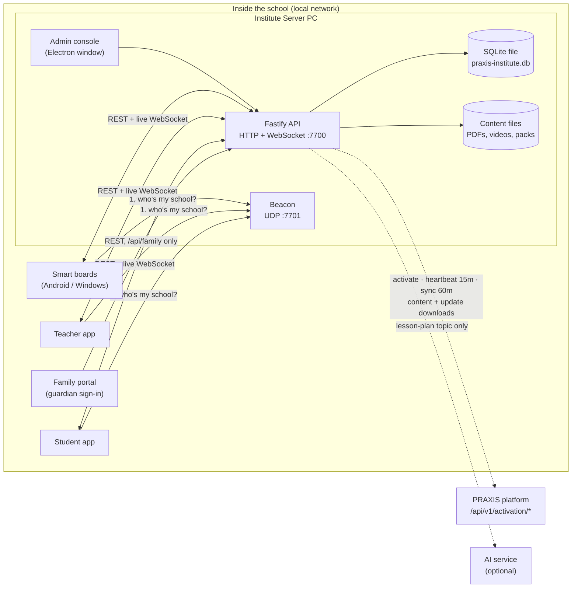
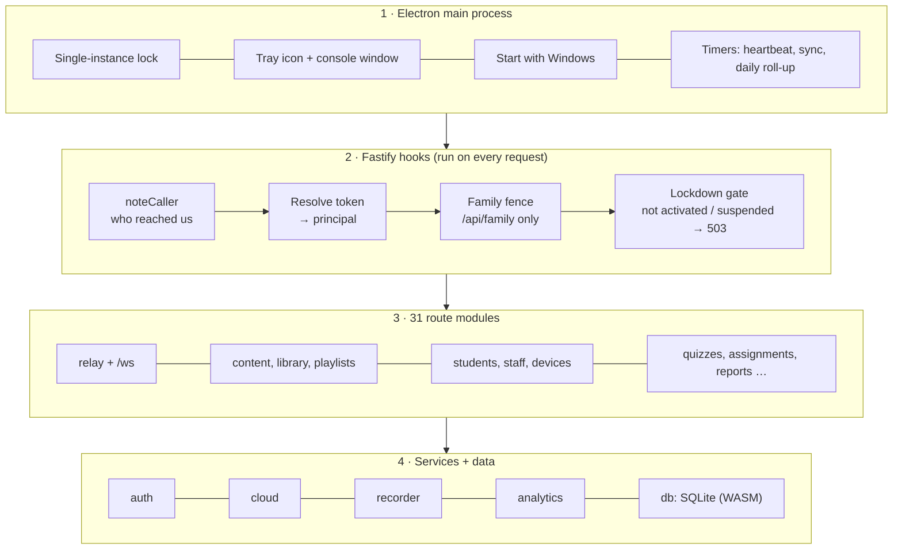
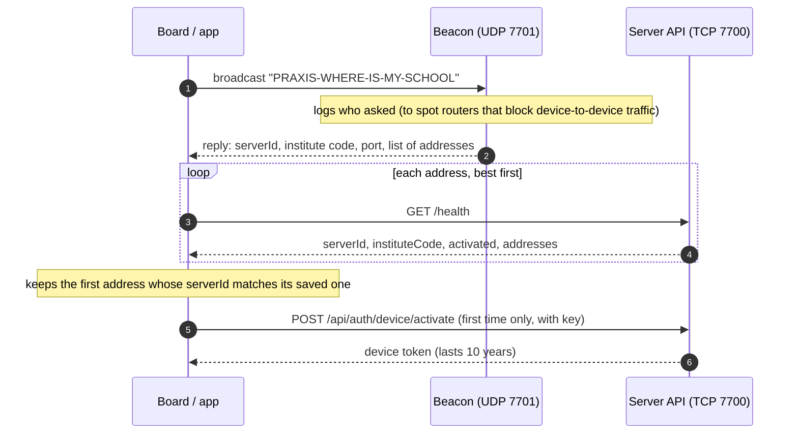
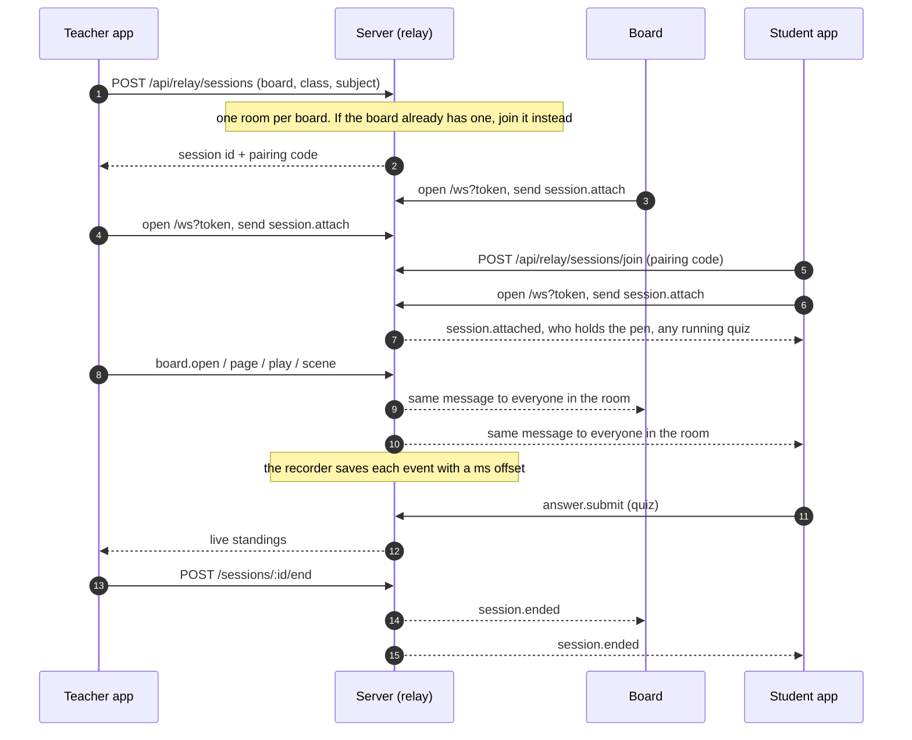
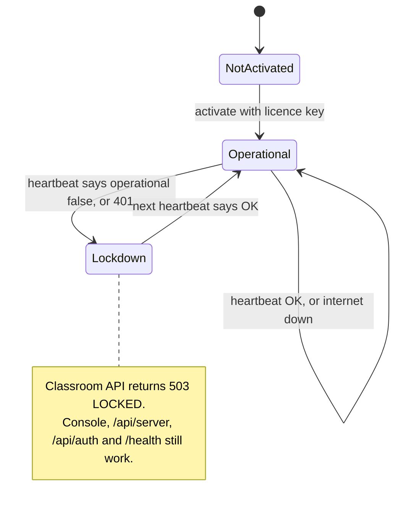
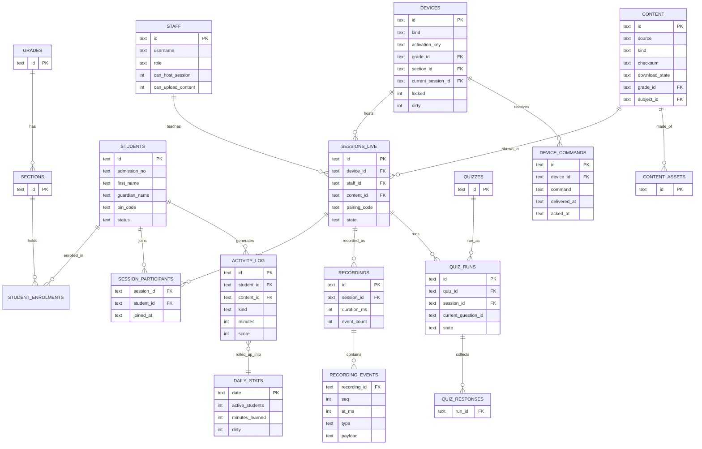

Reverse-engineered · PRAXIS 1.1.0

# How PRAXIS works under the hood

PRAXIS is a classroom system for schools. Each school runs one server on its own PC. Every smart board, teacher tablet and student device in the building talks to that server over the school's local network. The internet is only used for the licence, new content and a daily summary.

- **Source:** 3 Windows installers + 1 Android APK
- **Server code:** ~19,000 lines of readable JS
- **Built by:** PRAXIS Technologies / Whitebox Lab

**Legend:** **[observed]** read directly from the code · **[inferred]** a reasonable guess from the code · **[unknown]** not visible in these files

Part 1 · High-level design

## The big picture

Think of PRAXIS as a **small private cloud inside each school**. The school's server is the centre. Everything else connects to it.

- **One server per school.** It's a Windows desktop app that keeps running in the system tray. It hosts a web API on port `7700` and answers "where are you?" questions on UDP port `7701`. **[observed]**
- **Classroom devices only talk to that server.** Boards, teacher apps and student apps never call the internet during a lesson. **[observed]**
- **The cloud is a background helper.** Every 15 minutes the server checks its licence ("heartbeat"). Every 60 minutes it syncs content and a summary of usage. If the internet is down, the school keeps working. **[observed]**
- **Student data stays in the building.** Names, marks and attendance live in one SQLite file on the server PC. Only counts (like "312 minutes learned today") go to the cloud. **[observed]**

## The five parts

What came in the folder, and what each piece actually is.

#### Institute Server

PRAXIS-Institute-Server-Setup.exe

An Electron app (a desktop app built with web tech). Inside it is a **Fastify** web server, a **SQLite** database and an admin console written in React-style JS. It needs admin rights to install.

#### Teacher app

PRAXIS-Teacher-Setup.exe

A **Flutter** app compiled for the web, wrapped in a small Electron shell. The shell's main job is to find the school server on the network before the app starts.

#### Student app

PRAXIS-Student-Setup.exe

The **exact same code** as the teacher app. The only difference is one line in `package.json`: `"praxisRole": "student"`. The app switches screens based on that role.

#### Smart board

PRAXIS-Board.apk

A Flutter app for Android panels. It shows lessons, PDFs, Office files, videos and quizzes, and has a whiteboard with pen strokes. The desktop shell can also run as a board on a Windows PC.

#### PRAXIS platform (cloud)

http://80.225.219.245

The central service. It issues licences, holds the shared content library and app updates, and receives each school's daily totals. Its own code isn't in these files. **[unknown]**

## Architecture map

Solid lines happen during the school day over the local network. Dashed lines are the background trips to the internet.

Every device finds the server with one UDP broadcast, then switches to normal HTTP and a WebSocket for live lessons.

## Key design choices

The code is full of comments explaining *why*. These are the choices that shape everything else.

#### A · Offline first

The school must keep teaching when the internet is down. So nothing is sent to the cloud while a request is being handled. Cloud calls run only on timers, and if one fails it's logged and tried again later.

#### B · Remember who the server is, not where it is

School routers hand out new IP addresses all the time. So a board saves the server's **ID**, not its IP. On start it shouts "PRAXIS-WHERE-IS-MY-SCHOOL" on the network and the server replies with every address it can be reached on.

#### C · Download once, share many times

Content and app updates are downloaded once by the server over the school's single internet line. Then 300 tablets fetch them from the server over the local network.

#### D · The licence can switch the school off

If the platform says the licence is revoked, the server enters **lockdown**. Classroom requests get a 503 error, but the admin console still works so staff can see why. A dead internet line alone never causes lockdown.

#### E · Record the lesson, not the room

"Recording" doesn't save video. It saves the list of events in the lesson: which file opened, which page, which quiz question. Each event gets a time offset in milliseconds, so the lesson can be replayed.

#### F · Watching is always visible

The office can see a board's screen and a teacher can see a student's screen. But the watched device is **always told** and shows an indicator. Frames are only passed along live and never saved.

#### G · Pick tools that install cleanly

SQLite runs as WebAssembly instead of a native module, so it never needs rebuilding for a school's Windows setup. The Windows apps are Flutter web builds inside Electron, so no Visual Studio is needed to build them.

## What leaves the school

The database file's own header says: *"Student and staff records NEVER leave this file."* The sync code matches that. **[observed]**

#### Stays on the server PC

- Students, guardians, staff, passwords (as hashes)
- Attendance, marks, quiz answers, report cards
- Per-student activity log
- Messages, notices, assignments, submissions
- Lesson recordings (event lists)
- "Next steps" for a child, worked out locally with no AI

#### Sent to the PRAXIS platform

- Licence key, machine ID, MAC address, hostname
- Device list: name, type, serial, app version, last seen
- Daily totals: active students and teachers, lessons, minutes learned
- Server's LAN address and port, app version
- AI lesson-plan requests: topic, class and length only

Part 2 · Low-level design

## Inside the server

The server has four layers. A request passes through them top to bottom.

Closing the console window doesn't stop the server. It hides in the tray, because every classroom depends on it.

### Startup order

1.  Take the single-instance lock. Two copies would fight over the port and the database.
2.  Open the database, run the schema, add any missing columns from older versions, then build indexes.
3.  Fill in any missing daily totals and close recordings left "running" by a crash.
4.  Start Fastify on `0.0.0.0:7700`, then the UDP beacon on `7701`.
5.  Install the starter activity pack (`.praxis` files, such as `class-1--addition-apple-tree`).
6.  Show the window, build the tray, start the timers. Startup errors go to `startup.log` next to the database.

## Sign-in and roles

Every request carries a token. The server turns it into a **principal**: who you are and what kind of user you are.

| Kind | How they sign in | Session lasts | What they can reach |
|----|----|----|----|
| **admin** | Email + password. The account comes down from the cloud at activation. | 1 day | Everything |
| **staff** | Username + password | 1 day | Staff routes. Can host lessons and upload material only if allowed. |
| **student** | Username + password, a PIN, or an enrolment code | 1 day | Own work, library, joining lessons. Can't open a lesson. |
| **device** | Board enters its activation key once | 10 years | Hosts its own room only |
| **guardian** | Family PIN for one child | 7 days | `/api/family/*` only. Blocked from the live WebSocket. |

### How tokens work

- A token is 32 random bytes. The server stores only its **SHA-256 hash**, so a stolen database doesn't hand over live tokens.
- Passwords are stored as **bcrypt** hashes (cost 10).
- The token is sent as `Authorization: Bearer …`. GET requests and the WebSocket can also send it as `?token=`, because a video player or image tag can't set headers.
- Permissions are re-read from the database on every request. When the office flips a switch, the teacher's app sees it on its next call.

## Finding the server

This is how a board or app finds its school without anyone typing an IP address.

Virtual network adapters (Hyper-V, WSL, VPN) go to the back of the address list, because tablets can't reach them.

The server also tracks devices that **ask** but never **connect**. That pattern means the Wi-Fi router is blocking devices from talking to each other (often called "AP isolation"), and the console warns about it.

## A live lesson, step by step

The relay is the heart of the product. It's an in-memory switchboard: each lesson is a "room", and the server passes messages to everyone in that room.

### How the relay holds state

- `connections`: a map of every open socket and its principal. **[observed]**
- `rooms`: session ID → the set of connections in it.
- `watchers`: board ID → office users watching its screen. A second map does the same for teacher → student.
- All of this lives **in memory only**. A socket that closes is simply gone. Durable facts (the session, its participants, the quiz run) go to SQLite.
- Late joiners are sent the current state when they attach: pen holders, a running quiz, what's on screen. Without that they'd sit on "wait for your teacher".
- Each message is handled inside a `guarded()` wrapper. One bad message is dropped and logged; it can't crash the server for the whole school.
- Screen frames larger than ~700 KB are dropped rather than queued, so a slow room shows an older picture instead of using up memory.

### Fallback when the socket isn't there

Admin commands to a board (lock, reload, open) are also written to the `device_commands` table. The board can collect them with `GET /api/devices/:id/commands` and confirm with `/ack`, so a command isn't lost if the board was offline when it was sent. **[inferred]**

## WebSocket messages

All messages are JSON with a `type` field. The server accepts two shapes, fields at the top level (Flutter apps) or nested under `payload` (console), because both were already in use.

#### Joining

client ⇄ server

`connected` · `session.attach` · `session.attached` · `roster.update` · `roster.left` · `session.ended` · `ping` · `pong` · `error`

#### Driving the lesson

teacher → room

`board.open` · `page` · `scene` · `play` · `pause` · `seek` · `media.control` · `playlist.at` · `split.set` · `activity.open` · `activity.at` · `state.push`

#### Pen and whiteboard

shared ink

`annotate.request` · `annotate.decide` · `annotate.granted` · `annotate.refused` · `annotate.holders` · `annotate.stroke` · `annotate.undo` · `annotate.clear` · `whiteboard`

#### Screens and casting

live frames, never stored

`cast.start` · `cast.frame` · `view.watch` · `view.unwatch` · `view.frame` · `view.watching` · `watch.student` · `unwatch.student` · `watch.state` · `watch.refused` · `screen.frame` · `screen.report` · `board.screen`

#### Quizzes

live class quiz

`quiz.started` · `quiz.question` · `answer.submit`

#### Device and system

server → devices

`command.ack` · `board.activity` · `content.changed` · `update.ready`

## Cloud sync and licence

The server talks to the platform through five endpoints under `/api/v1/activation/`, using a `server_token` it receives at activation.

| Call | When | Sends | Gets back |
|----|----|----|----|
| `POST /activate` | Once, at install | Licence key, machine ID, MAC | Institute profile, admin account, classes, subjects, languages, content list. Saved in one transaction. |
| `POST /heartbeat` | Every 15 min | Machine ID, version, LAN address, quick stats | Whether the school may operate, subscription details |
| `POST /sync` | Every 60 min | Changed devices and daily totals (rows marked `dirty`), content cursor | New or changed content, games, app releases, admin updates |
| `GET /content/:id` | After sync | (nothing) | The file. Downloaded one at a time, checksum-verified. |
| `GET /release/:id` | When an admin chooses | (nothing) | App installer, checksum-verified, then shared to devices over the LAN |

### Licence states

The cloud address is resolved in this order: an admin setting, then the address used at activation, then the one built into the app. The app can be moved to a new platform host without reinstalling. **[observed]**

## Database

One SQLite file, `praxis-institute.db`, with **63 tables**, in the app's user-data folder. Foreign keys are on. Upgrades add missing columns at startup rather than running numbered migrations.

| Area | Tables |
|----|----|
| **Licence & system** | `activation` (exactly one row) · `meta` · `settings` · `audit_log` · `app_releases` |
| **People & sign-in** | `admins` · `staff` · `staff_assignments` · `students` · `sessions` (tokens) · `enrolment_codes` · `device_pins` |
| **School structure** | `grades` · `sections` · `subjects` · `grade_subjects` · `languages` · `student_enrolments` · `student_subjects` · `timetable_periods` · `timetable_entries` |
| **Devices** | `devices` (incl. lock state, current lesson, `dirty` flag) · `device_grades` · `device_commands` |
| **Content** | `content` · `content_assets` · `content_targets` · `content_notes` · `content_progress` · `playlists` · `playlist_items` · `learning_paths` · `learning_path_steps` · `activities` · `activity_targets` · `external_activities` |
| **Live lessons** | `sessions_live` (with `pairing_code`) · `session_participants` · `whiteboards` · `whiteboard_pages` · `recordings` · `recording_events` · `study_rooms` · `study_room_members` · `planned_lessons` |
| **Assessment** | `quizzes` · `quiz_questions` · `quiz_options` · `quiz_runs` · `quiz_run_teams` · `quiz_responses` · `activity_runs` · `external_runs` · `assignments` · `assignment_references` · `submissions` · `report_cards` |
| **Tracking** | `attendance` · `activity_log` (per student, never sent) · `daily_stats` (totals, synced) |
| **Communication** | `messages` · `notices` · `notice_targets` |

### Core relationships

## API map

**258 HTTP endpoints** in 31 modules, plus `/health` and the `/ws` WebSocket. All JSON, checked with **zod**. Errors look like `{"error": {"code", "message"}}`.

| Group | Modules (endpoint count) |
|----|----|
| Live classroom | relay (14) · quizzes (19) · classroom (11) · lock (5) · recordings (6) · study (6) · activities (8) · external (8) |
| Content | content (11) · library (13) · playlists (8) · paths (9) · planner (8) · ai (3) |
| People | auth (7) · students (8) · staff (7) · enrolment (5) · family (9) |
| School admin | academics (5) · timetable (6) · assignments (11) · reportcards (7) · notices (4) · messages (6) |
| Devices & server | devices (15) · server (12) · settings (9) · updates (5) |
| Insight | analytics (6) · reports (6) |

Live classroom endpoints

`GET /api/relay/bootstrap` `GET /api/relay/content` `POST /api/relay/sessions` `GET /api/relay/sessions/mine` `POST /api/relay/sessions/join` `POST /api/relay/sessions/:id/end` `…/open` `…/playlist` `…/split` `…/room` `…/cast` `…/activity` `GET /api/relay/sessions/active` `GET /ws`

`POST /api/quiz-runs` `…/teams` `…/advance` `…/answer` `…/finish` `GET …/standings` `GET …/live` `GET …/results` `POST /api/quizzes/:id/self-paced`

`GET/PUT /api/lock/policy` `POST /api/devices/:id/lock` `POST /api/lock/all` `POST /api/lock/unlock`

`POST /api/recordings/start` `POST /api/recordings/stop` `GET /api/recordings/live`

Devices and server endpoints

`GET/POST /api/devices` `POST /api/devices/state` `POST /api/devices/ping` `POST /api/devices/:id/command` `…/control` `…/status` `…/rekey` `GET …/watching` `GET …/commands` `POST /api/devices/commands/:commandId/ack`

`GET /api/server/status` `POST /api/server/activate` `…/reactivate` `…/heartbeat` `…/sync` `…/deactivate` `…/fetch-all-content` `…/download-content` `POST /api/server/firewall/allow` `GET /api/server/audit`

`GET /api/updates` `GET /api/updates/check` `POST /api/updates/:id/download` `GET /api/updates/:id/file`

People and sign-in endpoints

`POST /api/auth/admin/login` `…/staff/login` `…/student/login` `…/student/enrol` `…/student/pin` `…/device/activate` `GET /api/auth/me` `POST /api/auth/logout`

`POST /api/family/login` `GET /api/family/home` `GET /api/family/reports` `GET/POST /api/family/messages` `PUT /api/family/language`

`POST /api/students/bulk` `POST /api/students/:id/enrolment-code` `POST /api/enrolment-codes/class` `POST /api/students/:id/guardian-pin`

## The client apps

### Desktop shell (teacher, student, Windows board)

- **One codebase, three roles.** `main.js` is the same file in both installers. The role comes from `package.json`, and each role gets its own profile folder so they don't overwrite each other.
- **Local web server.** The Flutter web build is served from a loopback HTTP server on a **fixed** port. A random port would wipe saved sign-ins on every launch, because browser storage is tied to the port.
- **UDP discovery before start.** The shell does the broadcast a browser can't, then hands the server address to the app.
- **Locked down.** No downloads, no Save As, no printing, no DevTools, no opening the real browser. Only camera and microphone are allowed. Screen capture by the page is refused; casting goes frame by frame through the server.
- **Strict content policy.** Scripts load only from the app itself and YouTube (for embedded lesson videos).
- **Quick apps.** Through `praxis:apps:list` / `praxis:apps:open`, the board can launch games installed on the PC. These are the "external activities" the platform grants.

### Android board (APK)

A Flutter app compiled to native code (`libapp.so`). Module names found in it: **[observed]**

#### Connection

`locator` · `server` · `relay` · `key_field` · `updater`

#### Screens

`searching` · `setup` · `home` · `lesson` · `lock` · `quiz` · `cast` · `camera` · `split` · `activity` · `notices` · `register_sheet`

#### Content viewers

PDF (pdfium) · Office and legacy Office · video links · `playlist` · `media_transport`

#### Whiteboard

`ink` · `annotation_layer` · `whiteboard_screen` · Devanagari typing support

Part 3 · Review

## Things to watch

Points a security or architecture reviewer would raise. Each one comes straight from the code. **[observed]**

#### Cloud traffic is plain HTTP to a bare IP

Licence tokens and institute details go to `http://80.225.219.245` unencrypted. The code's own comment admits this and says it must be fixed on the platform side.

#### No encryption on the school network

Devices talk to the server over plain HTTP and WebSocket. Anyone on the same Wi-Fi can read tokens and lesson traffic.

#### Tokens in URLs

GET requests and the WebSocket accept `?token=`. URLs often end up in logs and history.

#### Very open CORS

`origin: true` with credentials allowed means any web page can make calls to the server from a browser on the school network.

#### Large uploads allowed

The body limit is 512 MB, with up to 20 files per upload. A misbehaving client could fill the disk.

#### The client IP can be faked

`trustProxy` is on and `clientIp()` reads `X-Forwarded-For`, so the IP a device reports for itself can be spoofed.

#### Boards hold 10-year tokens

Admins can re-key a lost board (`/rekey`), but someone has to notice it's gone first.

## What we don't know

- **[unknown]** How the PRAXIS platform works inside: its database, its admin panel and how it hands out content. Only its API from the client side is visible.
- **[unknown]** The AI service. It's switched off unless `PRAXIS_AI_URL` is set, and no address is built into this version.
- **[inferred]** The Flutter apps' screen logic. It was read from compiled strings and endpoint names, not decompiled. The server side is complete; the client side is a map, not a full read.
- **[unknown]** `RDP-MultiUser-v3.9.5.rar` was left out on purpose. It isn't part of PRAXIS, and tools like it are often flagged as malware.

Made by reading the unpacked PRAXIS 1.1.0 installers: the server's `app.asar` (TypeScript compiled to readable JavaScript, with comments), the desktop shell's `main.js`, the Flutter web bundle and the Android `libapp.so`. Endpoint counts, table names and message types are taken from the code, not estimated.
